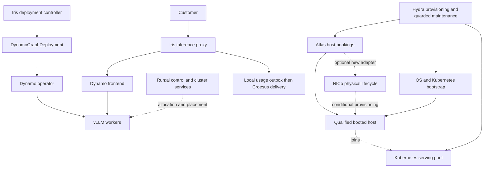

# Atlas, Run:ai, and Dynamo: Lyceum inference MVP and architecture assessment

**Updated:** 26 October 2026. **Method:** Elephant–Goldfish Model (EGM). **Status:** proposed deployment and migration plan; nothing here asserts that the platform has been deployed or qualified. **Fleet design target:** 10,000 GPUs on approximately 1,250 eight-GPU hosts; initial case 1,000 GPU hosts/8,000 GPUs, fewer than 10,000 CPU hosts and 1,000 storage hosts across **N main sites (N ≥ 3) plus P small sites with tens of machines each**.

## 1. Decision and MVP boundary

Build the MVP by **reusing Atlas/Hydra for hosts, establishing Kubernetes with Run:ai, deploying Dynamo, then migrating the existing Iris inference product**. Atlas books whole hosts; Hydra prepares and joins them; Run:ai governs GPU workloads; Dynamo serves models; Iris retains the customer contract. Keep one owner at each layer and use fixed protected capacity initially.

This is a reasonable route to a working inference MVP and a partial implementation of the proposed architecture. It is not a complete implementation of either execution specification. The most useful immediate improvements are explicit ownership, reproducible deployment, durable reconciliation, protected serving capacity, and controlled hardware maintenance. Installing the platform components does not establish those properties by itself.

NICo is a **conditional physical lifecycle component**, not a dependency of the first inference deployment. Use it if the new site needs automated discovery, firmware alignment, boot provisioning, hardware isolation, or sanitization that existing host operations cannot provide. Atlas assumes a qualified booted host; it does not replace those capabilities. Sites may provide full physical lifecycle control or host access only; NICo is applicable only where the required hardware authority and interfaces exist. Make that hardware decision in Phase 0 and qualify NICo separately if needed.

Direct vLLM remains a baseline and fallback. Batch products, discounted inference, fine-tuning, RL, HPC, agents, Kueue, fractional GPU sharing, custom scheduling, and transparent migration are later work. The MVP does not implement the general-purpose execution platform.

Use the supplied documents in this order:

1. [Architecture and production design patterns](<Architecture design patterns.md>) defines the principles to assess.
2. [Cluster execution architecture](architecture-20261014.md), revised 15 October, explicitly overrides conflicting requirements in the scheduling document.
3. [Scheduling and queueing specification](scheduling-queue.md) supplies workload requirements and acceptance scenarios where consistent with the revised architecture.

In particular, PostgreSQL supersedes the initial OpenRaft proposal; stable task IPs are optional; workload objectives require admission and measured capacity; advanced sharing and migration remain candidates. The revised architecture explicitly permits an initial Kubernetes integration that delegates placement and Pod execution. Its native-first delivery sequence and Rust implementation preference are not prerequisites for this inference migration. Record this as a deliberately narrower delivery profile, not as full conformance.

### What counts as a working MVP

| Milestone | Required demonstration | What it does not establish |
|---|---|---|
| AWS functional MVP | Run:ai governs a real GPU workload; Dynamo serves a small model through Iris with authentication, streaming, cancellation, and reconciled test billing. An isolated Atlas fixture verifies booking/control contracts separately from AWS VM ownership. | Physical host bootstrap/release, production availability, large-model performance, or datacenter autonomy. |
| Site integration MVP | Atlas books one qualified eight-GPU host; Hydra joins it to the supported Kubernetes profile; Run:ai and Dynamo serve through Iris; guarded drain/release and controlled recommission are exercised. | Atlas multi-node cluster delivery, automatic sanitization, or continued TP8 serving after loss of a single host. |
| Limited production pilot | Two independent complete model replicas, protected capacity, tested recovery and routing reversal, real-model compatibility, isolated tenants, durable billing, and the operational gates below. | The complete general-purpose execution architecture, every workload class, or a fleet-wide availability claim. |

First migrate one inference model and selected test tenants. Use a small text model on AWS; qualify an actual Lyceum production model before paid traffic. Preserve the incumbent platform through the pilot. A working endpoint is an early milestone, not the production release criterion.

## 2. Evidence and current Lyceum position

The assessment is based on source and documentation, not live production inspection. Deployment locations, actual SLOs, machine inventory, operating procedures, and existing exceptions need confirmation in Phase 0.

| Checkout | Source snapshot inspected |
|---|---|
| Lyceum | `ca2e49e1adfe1de9a4308902722efc017bdec075` |
| Atlas | `8eb928290526a9a54452877866bc4fd6bec170f5` |
| NICo (`nvidia/infra-controller`) | `75b36afadad68986c1d05650f3455710705935ff` |
| Run:ai | `593b9d5acddc9b0909cd09e9219a7453b8117566` |
| Dynamo | `ee0120922eef6278a25fe94ad491f02aa8aa038e` |

### Existing mechanisms and migration gaps

| Area | Evidence in Lyceum | MVP implication |
|---|---|---|
| Product separation | [Root README](../lyceum/README.md) separates Iris, Execlets, and bare VMs. | Migrate Iris and an explicitly assigned GPU pool. Do not change other customers' allocations. |
| Customer-facing inference | [Iris provider](../lyceum/iris/inference_proxy/internal/provider/iris/provider.go), [routing](../lyceum/iris/inference_proxy/internal/routing/serverless_router.go), and [tenant handling](../lyceum/iris/inference_proxy/internal/provider/iris/tenant.go) already supply direct chat, streaming, admission, and tenancy. | Preserve this product boundary above Dynamo. |
| Kubernetes and Dynamo | [Manifest builder](../lyceum/iris/deployment_controller/internal/k8smanifest/build.go) already builds StatefulSets and `DynamoGraphDeployment` objects. It expects one frontend component and one worker component, and applies GPU placement/colocation rules. | Adapt the existing DGD path. Start with aggregated serving; separate prefill/decode is outside MVP. |
| Authentication gap | `buildDGD` explicitly notes that the graph does not enforce the direct-vLLM API-key mechanism. [Endpoint construction](../lyceum/iris/inference_proxy/internal/provider/iris/endpoints.go) sending a bearer header does not fix this. | Require an authenticated ingress boundary or an enforced proxy-only network boundary before customer access. |
| StatefulSet dependencies | `modelAndWorkerContainers` requires both model and inference-worker containers. [Worker startup](../lyceum/iris/inference_worker/src/main.py) retains queue/state dependencies. | Baseline direct serving still needs its existing sidecar services. Do not label it dependency-free. |
| Lifecycle durability | [Lifecycle service](../lyceum/iris/deployment_controller/internal/lifecycle/lifecycle.go) inserts a database row, seeds Redis, then applies Kubernetes objects. Failed creation performs bounded, best-effort cleanup; its comment explicitly says cleanup failure can leave GPUs occupied with no retry. | Add durable desired state and retry/reconciliation for this boundary. This is a concrete architecture gap that the vendor stack will not repair. |
| Release semantics | [Deployer](../lyceum/iris/deployment_controller/internal/deployer/deployer.go) distinguishes accepted deletion from Pods actually being gone. | Never use API deletion acceptance as proof that a host or GPU is safe to reclaim. |
| Canary routing | [Store resolution](../lyceum/iris/deployment_controller/internal/store/store.go) selects the newest nonterminal deployment for a serving name; [proxy cache](../lyceum/iris/inference_proxy/internal/app/cache.go) resolves one deployment ID. | Add explicit activation/cohort routing before a production canary. A same-name deployment is not automatically zero traffic. |
| Disruption protection | [PDB construction](../lyceum/iris/deployment_controller/internal/k8smanifest/scaling.go) selects the deployment label. DGD workers deliberately lack that HTTP frontend selector. PDB creation currently warns rather than failing deployment. | Add separate frontend/worker budgets, verify their selectors, and block pilot activation when required protection is absent. |
| Autoscaling | `ApplyAutoscaling` rejects DGD workloads; existing KEDA resources target StatefulSets. | Fixed replicas and fixed node capacity for MVP. Do not introduce an additional replica writer. |
| Health and namespace ownership | [Iris operator](../lyceum/iris/iris_operator/README.md) runs one replica without leader election. [Dynamo health](../lyceum/iris/iris_operator/internal/controller/endpoint/dynamo.go) requires frontend and workers. Controllers are configured for one namespace. | Use one Run:ai serving project initially, with customer isolation in Iris. Test stale health and operator restart; do not simply add replicas. |
| Storage and runtime portability | [Storage builder](../lyceum/iris/deployment_controller/internal/k8smanifest/storage.go) hardcodes `local-path`; [GLM image](../lyceum/iris/model_image/glm53flash-dynamo/Dockerfile) and [multimodal fixes](../lyceum/iris/model_image/_shared/dynamo_mm/README.md) carry model-specific behavior. | Introduce a storage/placement profile and qualify patched production images separately from the small stock model. |
| Billing | [Croesus proxy integration](../lyceum/iris/inference_proxy/internal/croesus/doc.go) reports asynchronously and fails open for infrastructure errors; [replica billing](../lyceum/iris/deployment_controller/internal/replicabilling/replicabilling.go) is separate. [Usage reporting](../lyceum/iris/inference_proxy/internal/croesus/usage.go) begins in memory; the [Redis spool](../lyceum/iris/inference_proxy/internal/croesus/spool.go) removes a retry batch before acknowledgment and drops oldest events on overflow. | Current delivery is best effort across those failure windows. Add durable receipt and acknowledged retry before claiming durable pilot billing. Retain existing event IDs and Croesus deduplication. Run:ai accounting does not replace this work. |
| Host booking | Hydra's [Atlas provider](../lyceum/infra/services/hydra-autoscaler/internal/providers/atlas/instance_manager_backend.go) already creates idempotent bookings, polls readiness, obtains SSH access, and releases bookings. Atlas [allocation](../atlas/atlas/internal/repository/booking_pick.go) is transactional; its [reconciler](../atlas/atlas/internal/reconciler/reconciler.go) drives vendor effects asynchronously. | Reuse this path. One eight-GPU machine is one booking, retained for the serving pool across model deployments. |
| Host preparation | Atlas's [manual adapter](../atlas/atlas/internal/vendor/manual.go), also selected in auto mode, probes a booted host and installs access keys. Its multi-node `CreateCluster` returns unsupported; the mock's cluster result is not production functionality. | Book hosts individually. Reuse Hydra's [provisioning interface](../lyceum/infra/services/hydra-autoscaler/internal/autoscale/provisioning.go) and qualify OS/Kubernetes bootstrap. NICo or another physical provider is needed only where Day 0 capability is missing. |
| Physical-site selection | Hydra's Atlas pool prefix is `customer_id` attribution; the backend rejects placement constraints and its booking request omits Atlas's location filter. The single-node picker otherwise searches matching inventory. | Add server-enforced pilot inventory eligibility. A customer/pool label alone does not reserve the new site's hosts or exclude other sites. |
| Credential handoff | Atlas's `installCustomerKey` overwrites `authorized_keys` with the booking key before readiness is persisted. With distinct Atlas/Hydra keys, a crash or failed readiness check can leave Atlas unable to retry. | Preserve a restricted management access path and make credential installation/revocation recoverable and assignment-bound. Host-key verification alone does not fix this. |
| Host release risk | Atlas [drain](../atlas/atlas/internal/repository/node.go) can force-release bookings under rental policy. Its [wiper](../atlas/atlas/internal/wiper/worker.go) calls the vendor before recording the task handle. | Add a protected-serving release gate across every ordinary mutation entry point. Disable automatic wiping for the pilot pool until external-effect recovery is qualified. |
| Infrastructure automation | [Hydra autoscaler](../lyceum/infra/services/hydra-autoscaler/README.md), [k3s role](../lyceum/infra/ansible/playbooks/roles/k3s_server/tasks/main.yml), and [hybrid-node role](../lyceum/infra/ansible/playbooks/roles/aws_eks_hybrid_node/) cover parts of provisioning and node join. | Preserve those interfaces, but qualify a Run:ai-supported Kubernetes profile. Disable automatic capacity deletion for the fixed pilot pool. |
| Atlas operating profile | [Atlas Terraform](../atlas/infra/terraform/cloud_run.tf) deploys internal workers/API and a public API/UI against PostgreSQL. The supplied profile uses Cloud Run/Cloud SQL with one active worker service. | Reuse the existing deployment for the initial site pilot with an explicit WAN dependency. Test worker restart and overlapping revisions; do not clone its allocation database into an independently active local authority. |

### Why Atlas is the default and NICo is conditional

Atlas is a capacity broker; NICo is a physical infrastructure controller. They overlap in inventory, host allocation and release, but neither is the GPU Pod scheduler or inference engine.

| Dimension | Atlas/Hydra already available | NICo contribution if required |
|---|---|---|
| Host contract | Transactional whole-node booking, ownership, idempotency and asynchronous reconciliation; existing Hydra client. | New integration needed to map Atlas booking/node IDs to physical machine/instance operations. |
| Day 0 and Kubernetes | Atlas assumes a booted reachable host; Hydra supplies bootstrap/join. The real Atlas adapter's multi-node cluster delivery is unsupported. | Discovery, firmware and OS boot delivery; Kubernetes assembly remains above NICo. |
| Health and isolation | SSH GPU/PCI/driver/fabric probes and endpoint reachability; booking exclusivity. These do not establish inference health or fabric isolation. | Qualified out-of-band/device lifecycle and hardware/network isolation; Flat/zero-DPU profiles leave network enforcement with the operator. |
| Return and reinstall | Manual wipe gate plus implemented [Gcore](../atlas/atlas/internal/gcore/wiper.go) and [Brokkr](../atlas/atlas/internal/brokkr/wiper.go) rebuild adapters. These provider APIs do not provision arbitrary owned bare metal. | Physical teardown and sanitization for the selected supported hardware profile. One provider must own the physical operation. |
| Operating burden and locality | Existing Go service/UI and PostgreSQL, deployed centrally on Cloud Run/Cloud SQL; worker recovery and overlapping revisions need qualification. | Additional site management stack, state, trust, workflows, and hardware prerequisites. Site-local operation is possible but still needs recovery qualification. |

Reuse makes Atlas the shorter path when qualified hosts are available. It does not demonstrate reliability equivalent to NICo: the responsibilities and failure modes differ. The default accepts a central booking dependency and controlled manual return where needed; it must close the release-protection and SSH-trust gaps before protected serving.

Prefer source over stale summaries: Atlas's root README says deployment files are missing, but the checkout includes them. The wiper guide's claimed protection against duplicate starts is not established by the implementation: the external `Start` precedes the durable task claim. Section 4 defines the resulting restrictions.

### Assessment against Architecture design patterns.md

“Partial” means there is relevant implementation but not evidence of complete conformance. “Gap” identifies a concrete missing mechanism or incompatible inspected path. “Unverified” means source alone cannot establish the production property.

| Principle | Current position and evidence | Effect of the migration | Required MVP action |
|---|---|---|---|
| Trees are better than graphs | **Partial.** Iris separates proxy, lifecycle, manifests, and operators, but synchronous creation spans database, Redis, and Kubernetes; runtime health calls back to lifecycle services. | Vendor controllers add more dependencies. Layering improves only with explicit ownership and bootstrap order. | Separate intent, execution, and observation paths; bounded retries/timeouts; no host operation that depends on a workload running on that host. A status callback is not itself a circular bootstrap dependency. |
| Locality | **Unverified.** [Proxy configuration](../lyceum/iris/inference_proxy/internal/app/config.go) and [controller configuration](../lyceum/iris/deployment_controller/cmd/deployment-controller/config.go) depend on Redis, Supabase/PostgREST/Auth, and service endpoints whose production locations are not established here. Cache misses and expiry still call upstream. | Local Kubernetes helps; central Atlas/Hydra, a remote Run:ai control plane, or global identity/state can retain WAN dependencies. | Keep serving control local; test WAN loss including cache expiry and restart. The initial central Atlas path cannot promise new bookings or release during WAN loss; document that locality exception. |
| Low dependency is survival | **Partial.** Existing direct-serving sidecars, identity, caches, billing, and health paths are real dependencies. Croesus asynchronous reporting is useful separation, but its current queue/spool has loss windows. | Atlas/Hydra reuses existing services; Run:ai adds a control stack. Deferring NICo avoids its additional management dependencies unless hardware requirements justify them. | Keep hardware control and remote billing delivery off the request path; make local usage receipt durable; give management bootstrap/recovery an independent path. Do not combine incompatible database or identity versions just to reduce counts. |
| Pets versus cattle | **Partial.** Kubernetes reconciliation and Ansible/Hydra automation exist. | Atlas supplies booking/reconciliation and Hydra supplies bootstrap; NICo could add physical discovery/provisioning later. | Prove repeatable booking, join, drain, and controlled recommission. Record any manual sanitization exception; keep physical repair governed. |
| Reliability follows SLO and cost | **Unverified.** Health, PDB, routing, and billing machinery exist, but repository code is not a measured availability result; DGD worker protection has a concrete gap. | Better placement cannot compensate for insufficient complete replicas or shared failure domains. | Establish one model's request SLO and failure load; keep two independent warm replicas and test node loss, control loss, and restoration. |
| Secure by default | **Gap in inspected paths.** DGD auth is missing; the [Hydra SSH helper](../lyceum/infra/services/hydra-autoscaler/internal/ssh/ssh.go) uses `ssh.InsecureIgnoreHostKey()`. This is not a claim about every deployed path. | Atlas also skips SSH host-key verification by default. NICo isolation, if added, would not secure Iris endpoints or bootstrap automatically. | Enforce endpoint access, least-privilege identities and networks; require authenticated host identity in any reused bootstrap path. Keep BMC credentials outside the workload cluster. |
| Hierarchical policies | **Partial.** Iris has customer/organization checks and dedicated/serverless pools. An atomic organization/team/service resource hierarchy across products is not established by the inspected code. | Run:ai supplies a resource hierarchy, but its entities are not automatically Lyceum's accounting owners or capacity commitments. | Map the platform's serving service to one department/project; preserve Iris tenant controls. Test parent quota denial and prohibit user bypass. Full customer hierarchy is later. |
| Zero Touch Prod | **Partial automation; strict conformance unverified.** SSH/Ansible paths exist. Automated SSH is not proof of manual production operation, but an unrestricted shell path conflicts with the stricter execution architecture. | Atlas/Hydra automation retains SSH and manual return paths. A conditional NICo installation would not automatically enforce Lyceum's access policy either. | Automated install/check/drain/restore entry points and audited access now. A production profile must either enforce the strict no-shell contract with sufficient recovery tooling or record a reviewed, time-bounded exception. |
| Intent separate from execution | **Gap at the Iris boundary.** Creation and cleanup are request-driven sequences; failed cleanup can strand resources. | Atlas already separates booking intent from provisioning; Kubernetes reconciles Pods. Iris lifecycle and ambiguous external wipe effects still need explicit recovery. | Persist intent before effects; use stable identities, restartable operations, and reconciliation in existing services. |
| Rate-limited mutations and Big Red Button | **No common mechanism established** across Iris, Hydra, Run:ai, Dynamo, and hardware lifecycle. | More controllers increase the risk of individually safe actions combining into a failure. | One serialized planned-maintenance lane, explicit disruption scope, bounded rollout rates, and a tested freeze of ordinary changes. State what native recovery and already-issued actions may still do. |
| Rolling forward preferred | **Partial.** Images and templates support controlled releases, but safe adoption routing is missing. | Reproducible releases help only if state/schema compatibility is preserved. | Prefer roll-forward repair; retain routing reversal and compatible old capacity as incident controls. Never assume a database downgrade is safe. |
| Incident management | **Unverified from code.** Logs, metrics, and health interfaces exist; on-call practice is not established. | Additional control stacks need additional failure diagnosis. | Named owners, useful alerts, operation timelines, node/drain/restore runbooks, and a completed recovery exercise. |

The main issue is not that Lyceum lacks orchestration. It already has substantial orchestration. The gaps are cross-system durability, bounded authority, dependency placement, and operational proof. Adding another scheduler without addressing these gaps would increase complexity while leaving the architecture problems intact.

## 3. Is this a good route to the two proposed architectures?

**Yes for the Kubernetes inference profile; no as a claim to implement the entire execution foundation.** Section 16 of the revised architecture is the useful integration contract. Use it to avoid replacing working Kubernetes machinery with a second native scheduler or allocation ledger.

| Requirement from the proposed documents | Contribution from the requested stack | Remaining work or conflict | MVP disposition |
|---|---|---|---|
| Durable workload intent and asynchronous effects (§§2, 6–7, 16) | Atlas transactional bookings and reconciliation; Kubernetes desired state. | Lyceum database/cache/Kubernetes operations still need durable reconciliation. No transaction spans all systems. | Add the small Iris reconciliation boundary and host-operation journal; do not build a universal state engine. |
| Replaceable scheduler and one execution owner (§§4–5, 16) | Run:ai's scheduler governs assigned Kubernetes workloads; kubelet executes Pods. | This does not implement the proposed `SchedulingView -> Proposal -> reliability authority` Rust API. | Delegate placement. Preserve object/operation IDs and adapter boundaries for later evolution. |
| Atomic allocation, quotas, epochs, and fencing (§§6, 8–9) | Atlas owns host bookings; Kubernetes and Run:ai govern workloads within those hosts. | No shared transaction or universal fence across Atlas, Hydra, Kubernetes, storage, and physical effects. | Exclusive GPUs, stateless serving, no shared mutable workload writer; block ambiguous host release and inspect actual state. Do not advertise generic exactly-once execution or universal fencing. |
| Local autonomous control (§3) | Site-local Kubernetes supports admitted serving; the supplied Atlas/Hydra deployment is central. | The central booking path is WAN-dependent; Kubernetes-hosted services also differ from the literal host-service-manager requirement. | Independently bootstrap local CPU/control capacity. Limit the initial autonomy claim to tested serving/recovery on already leased hosts; full local booking requires a separate migration. |
| Common durable backlog, batch/gang/agent controllers (§2; scheduling §§2–7) | Run:ai models workloads; Dynamo serves inference. | Neither replaces the full Lyceum queue, application progress SDK, agent journal, or checkpoint contracts. | An inference service is durable desired replicas, not a batch job. Defer the universal queue and all new workload products. |
| Hierarchical limits versus guaranteed capacity (§9) | Run:ai departments/projects and queues can constrain resource use. | Business limits, entitlements, and physical headroom remain distinct. | Platform serving project, fixed protected capacity, two test customers at the API. No guaranteed-start product. |
| Infrastructure inventory and repair (§11; scheduling §§10–11) | Atlas inventories/books existing hosts; Hydra bootstraps them. NICo is a conditional physical lifecycle provider. | Atlas rental release policies are not workload-aware drains. Neither host broker nor optional hardware provider supplies Iris SLO protection. | Explicit host-to-cluster adapter and guarded drain/release/rejoin workflow. |
| GPU useful output (§15) | Run:ai placement plus Dynamo serving may improve packing or throughput. | Neither creates nighttime demand nor proves utilization from allocation counters. | Measure latency-qualified goodput and fragmentation; record the reported 20% baseline without promising a target. |
| Logical identity and discovery (§14) | Deployment IDs and Kubernetes Services survive Pod replacement. | Discovery is not ownership fencing; stable IPv6 and socket migration are not supplied. | Stable service identity, replaceable Pods, explicit reconnect behavior. |
| Artifacts and local recovery (§§17–18) | Container registries, image digests, boot artifacts, retained model caches. | Local iroh distribution, signed seed semantics, total management recovery, and strict ZTP are not automatically implemented. | Reuse a local approved artifact source and explicit recovery inventory; do not build P2P transport for MVP. |
| Panic and disruption authority (§19) | Individual systems have pause, policy, rollout, or maintenance controls. | No verified global atomic freeze spanning Atlas, Hydra, Run:ai, Dynamo, and physical providers. | Scoped operational freeze plus a serialized maintenance workflow. Full authority-epoch panic remains a later design; do not claim equivalence. |
| Accounting (§21) | Iris/Croesus product meters, Run:ai allocations, and Atlas host bookings. | Different clocks, owners, and resource semantics require reconciliation. | Retain raw provenance; verify token and replica billing; never invoice the same GPU from two independent interpretations. |
| Rust and native runtime profiles (§§1, 12, 24) | Atlas/Hydra/Iris and the selected runtime stack include Go, Python, Kubernetes, and external services. | Not an all-Rust scheduler/authority/agent platform; no native OCI/KVM provider implementation here. | Keep existing languages and services. A Rust rewrite is outside MVP. |

The strongest case for proceeding is reuse: Atlas already connects to Hydra, Iris already creates DGDs, and Run:ai can govern the new pool. The strongest case against is adding platform dependencies before fixing release protection and recovery. Keep the MVP to one model, one site, one workload class, and explicit owners; add NICo only for a demonstrated physical lifecycle requirement.

If the desired result becomes literal implementation of every core clause in the proposed architecture, this migration is insufficient. That would be a separately estimated execution-platform program, including the authority/state contract, native execution, global mutation semantics, and full recovery qualification.

## 4. Deployment architecture and ownership

The host path is `Hydra -> Atlas booking -> qualified host`, followed by Hydra's OS/Kubernetes bootstrap. The request path is `customer -> Iris -> Dynamo -> model worker`. Atlas, Hydra, and any physical provisioning provider stay outside the inference request path.

Before booking, enforce a persisted allowlist of eligible physical node IDs for the pilot pool/customer in Atlas. Apply it to discovery, availability, allocation, retries and any preemption path; exclude protected pilot inventory from other customers. Propagate this constraint through Hydra's Atlas client/provider and reject missing or mismatched eligibility with no cross-site fallback. `customer_id` is attribution, and a broad location label is not a physical-site guarantee. This is a required extension to the existing integration.

Atlas leases whole hosts to the serving pool; Kubernetes allocates their GPUs to Pods under Run:ai policy. Atlas's booking scheduler is not a replacement GPU scheduler. Keep the host booking active across model starts/stops and replica changes. No other broker, Execlet pool, or native allocator may allocate the same host devices independently.

### Three layers and proposed team ownership

Organize ownership around decisions and service contracts, not a separate team per vendor. **Hardware owns qualified physical resources; Capacity owns their allocation and Kubernetes; Workload owns the customer result.** A process running on Kubernetes does not thereby belong to the Capacity team. The eight-slide companion summarizes these boundaries: [PDF](layers-and-ownership.pdf), [editable PowerPoint](layers-and-ownership.pptx), [browser deck](layers-and-ownership.html), and [speaker notes / sources](layers-and-ownership.md).

| Layer / accountable team | Software and systems | Owns | Does not own |
|---|---|---|---|
| **Hardware / Infrastructure** | Datacenter/OOB and fabric tooling; approved base OS images and physical provisioning automation; NICo if selected; storage service software, with the backend still to be chosen | Physical asset identity and capability contract; racks/power/cooling, BMC, firmware/boot, fabric, storage durability, repair and sanitization where Lyceum controls them; provider coordination and evidence elsewhere | Customer deployment state, Pod placement, model replica counts, prices or invoices |
| **Capacity / Platform** | Atlas; Hydra; supported Kubernetes distribution/etcd; Run:ai on AI pools; GPU Operator/device plugin/runtime; CNI and CSI; platform observability, secrets and database operations | Host eligibility/booking, cluster membership and node image profile, GPU/CPU allocation, namespaces/resource policy, safe drain, control recovery, supported network/storage classes | Model behavior, customer routing, billable-product semantics, physical repair or a competing host wiper |
| **Workload / Products** | Iris proxy/controller/operator; Dynamo and model runtimes such as vLLM; dedicated-inference product; machine-rental API; Croesus; API/web/CLI; existing Streamer/Execlet product on separate resources | Product identity, desired deployments, service SLO/admission, request routing, tenant authorization, usage facts and commercial ledger, customer experience | BMC commands, direct host deletion, direct writes to generated Pods, or independent GPU allocation on a Capacity-owned pool |

Within Workload, assign named **Inference**, **Compute products**, and **API/Commercial** owners as the team grows; these are responsibility areas, not a recommendation for three additional teams immediately. Croesus has one commercial-ledger owner. Each team owns its component's code, rollout, observability, on-call and recovery; Capacity supplies a hosting contract rather than inheriting all application operations.

Concrete software boundaries:

| Software / interface | Primary owner and decision | Boundary or action |
|---|---|---|
| NICo or existing physical provider | Hardware: provision/repair/sanitize a physical host | Optional below Atlas. It does not assemble Kubernetes, replace CSI/storage services, or schedule inference. |
| Atlas | Capacity: inventory eligibility and exclusive whole-host assignment | Its inventory is allocatable capacity; hardware facts come from Hardware. Lease one host to exactly one pool/customer at a time. |
| Hydra | Capacity: acquire hosts through providers, bootstrap/join, drain and return | Split its provider/physical calls from its Kubernetes bootstrap interface. Hardware supplies the base-image/provisioning contract; Hydra does not become a second firmware or wipe authority. |
| Kubernetes distribution, etcd and kubelet | Capacity: cluster lifecycle and Pod execution | Use a supported distribution, candidate RKE2 on site. Kubelet owns processes; no Execlet daemon allocating the same GPU devices. |
| Run:ai | Capacity: GPU workload placement, resource policy and operational accounting | Not customer billing or a replacement for Atlas's host lease. Do not install it on every ordinary CPU cluster without a requirement. Standard Kubernetes scheduling can serve those clusters. |
| GPU Operator / device plugin / container runtime | Capacity: driver/runtime/device profile | One installer for each driver/runtime field. If Hardware's image includes a driver, disable the competing installer and validate the version as a joint image contract. |
| Network | Hardware owns switches, links, routing and fabric; Capacity owns CNI/Service policy | Existing Cilium configuration is a reuse candidate, not a fleet qualification. Define routed prefixes, MTU, failure/throughput budgets and enforcement at the handoff. |
| Storage | Hardware/storage owner supplies durable object/block/file services; Capacity supplies CSI/StorageClasses | Workloads request capacity/performance/retention classes. A PVC is not a storage backend. Existing MinIO integration does not establish a 1,000-host storage design; provider block-volume documentation is partly a proposal. |
| Dynamo + vLLM | Inference owner: graph behavior, inference routing/batching and model execution | Capacity installs approved cluster-scoped CRDs/integration; Inference owns graph/runtime releases. Dynamo changes generated children; Iris changes the graph. |
| Iris | Inference owner: product deployment identity, routing, health, usage and selected replica policy | Fixed replicas for MVP; later choose one scaling controller. Customer-level shared/dedicated semantics remain here. |
| API/web/CLI | API/Commercial owner: identity, catalog, customer contracts and thin routing | Current `/app` still carries business logic. Move each migrated operation to its domain owner; do not add a second deployment writer. Web implementation was not established in this checkout, so assign ownership without inventing its stack. |
| Croesus | API/Commercial billing owner: prices, meters, balances, ledger and payment integration | Iris/Hydra emit idempotent usage facts. Atlas rental economics and Run:ai resource reports are evidence; they must not independently invoice the same product. |
| PostgreSQL, Redis, telemetry and identity hosting | Capacity owns infrastructure availability; each service owner owns schema/configuration and correctness | Separate compatibility, access and restore domains. Shared operational tooling does not justify one shared database or merging customer identity with Run:ai operator access. |

The [gateway documentation](../lyceum/docs/wiki/docs/core/explanations/gateway.md) and [current-state architecture](../lyceum/docs/wiki/docs/development/explanations/architecture-current-state.md) explicitly plan to move business logic out of `/app`. The current [Hydra behavior](../lyceum/docs/wiki/docs/core/explanations/hydra.md), [billing semantics](../lyceum/docs/wiki/docs/core/explanations/croesus.md), [block-storage proposal](../lyceum/docs/wiki/docs/core/explanations/block-storage.md), and [MinIO identity plugin](../lyceum/infra/services/minio-identity-plugin/README.md) distinguish implemented interfaces from intended ones. Confirm active deployed backends before retiring any writer.

### Two hardware authority profiles, one Capacity interface

The user operates **both lifecycle-controlled sites and sites with host access only**. Record this per host/pool, not merely per provider: ownership of the asset and permission to power, image or erase it are separate facts.

| Capability | Full lifecycle control | Host access only |
|---|---|---|
| Physical provisioning, BMC, firmware, power and repair | Lyceum Hardware team or its explicitly controlled automation | External provider; Lyceum requests action and records provider evidence |
| NICo | Candidate if hardware/interfaces fit and it has authority | Not a solution to missing BMC/lifecycle permissions; keep it out of this path |
| Atlas / Hydra | Lease eligible capacity; invoke the selected physical provider, then bootstrap Kubernetes | Lease eligible capacity; inspect and configure only the accessible host within granted permissions; no invented reboot/reimage/wipe calls |
| Base OS, driver and runtime | Versioned joint Hardware/Capacity profile; one installer | Qualify the provider image and permitted changes. If access cannot support kubelet/runtime/device setup, require provider bootstrap or exclude that host from this Kubernetes pool. |
| Failure/replacement | Controlled repair/reimage/recommission within the declared failure model | Quarantine, provider ticket/API and replacement/reconnection procedure; recovery time depends on the provider contract |
| Return and sanitization | Execute and verify the selected procedure | Remove Lyceum credentials and managed state where permitted; require provider sanitization/return evidence for stronger guarantees. SSH file deletion alone is not verified physical sanitization. |
| Protected serving | Guard Lyceum's ordinary mutations and the selected physical executor | Same guards for Lyceum actions; they cannot fence provider power-off, withdrawal or maintenance outside Lyceum's authority |

Extend `HostReady`/capacity inventory with `lifecycle_control`, `provider/site`, stable host identity, allowed operations, bootstrap privileges, maintenance notice/reclaim terms, replacement target and sanitization evidence. Admission chooses a compatible **capability profile**, not a product name. Unsupported operations fail explicitly and route to provider escalation; they must never fall through to a generic destructive command.

For host-access-only capacity, assess provider withdrawal/maintenance as an external failure. Use replicas across the promised failure domains, capacity reserve and tested routing to meet the selected SLO; neither PDBs nor Atlas protection can force the provider to preserve a host. A pool without the required access, notice, isolation or recovery terms cannot sell the corresponding guarantee. This narrows the guarantee rather than introducing a second scheduler.

### Duplicates to remove, and overlaps to retain

| Overlap | Risk | Single boundary for the target |
|---|---|---|
| Gateway's legacy inference lifecycle versus Iris controller | Both can create/scale/meter a deployment | For the migrated route, Iris is the sole lifecycle writer; gateway forwards intent. Inventory legacy consumers before removing that path. |
| Hydra scale-down, provider drain, Atlas reclaim/wiper, optional NICo teardown | Several paths can destroy the same capacity | One Capacity maintenance authorization; one Hardware/provider executor after verified workload release. |
| Run:ai versus another GPU scheduler or Streamer/Execlet | Double allocation of devices | One scheduler per resource pool. Existing Execlet and machine-rental hosts remain disjoint from Iris Kubernetes hosts until explicitly migrated. |
| Iris scaler, KEDA/HPA, Dynamo Planner, Run:ai/Knative inference scaling | Conflicting desired replica counts and request paths | Fixed Iris/DGD count now. Later select one scaling owner per deployment; do not add Run:ai's separate inference frontend/Knative path to this Dynamo route. |
| Ansible/image driver setup versus GPU Operator | Competing driver/runtime changes | Capacity publishes one versioned node profile and a single installer; Hardware delivers its agreed base. |
| Atlas readiness, Kubernetes Ready, Dynamo health, Iris health | Misleading substitution of one readiness signal for another | Retain all four for different scopes: access/hardware, allocatable node, model graph, customer endpoint. Only Iris declares product readiness. |
| Hydra/Atlas cost, Run:ai utilization, Iris meters and Croesus | Duplicate or inconsistent charges | Raw facts retain provenance; deduplicate raw events by source/event ID; Croesus aggregates priced transactions by meter, subject, transaction group and time period, rather than creating one ledger entry per event. |
| Physical network/storage control versus CNI/CSI | Two teams changing the same underlay or durability policy | Hardware owns backend/fabric; Capacity owns attachment/policy adapters; Workload selects declared classes. |

**Dedicated inference is not a dedicated machine rental.** An Iris customer reserving a model replica uses the same Kubernetes/Run:ai/Dynamo stack, with declared capacity and isolation. A whole-machine/VM rental follows the product API to Hydra/Atlas and the physical provider; that host is removed from the shared Kubernetes/Execlet pools. Customer-root rentals must not inherit the managed-serving Atlas automation credential profile. They need their own access-revocation and return/sanitization contract.

### Team handoff contracts

| Handoff | Producer supplies | Consumer accepts / returns |
|---|---|---|
| Hardware → Capacity | `HostReady`: asset ID, lifecycle-control profile/allowed operations, provider/site/rack/failure domains, hardware topology, image/trust identity, network/storage capabilities and health evidence | Capacity validates and records eligibility, leases the host and joins it. A host without proof remains quarantined. |
| Capacity → Workload | `CapacityClass`: cluster/site, GPU/CPU/memory topology, isolation, storage/network class, admission limits and failure assumptions | Workload submits versioned deployment intent and resource requests; receives admitted/pending/ready as separate states. Quota is not guaranteed physical capacity. |
| Workload → Capacity → Hardware | Maintenance request with affected deployments and surviving SLO capacity; then verified-empty-node release authorization | Capacity serializes drain and fences admission; Hardware acts only on the current scoped authorization. Emergency facility protection remains a separate governed path. |
| Runtime → Commercial | Durable `UsageEvent`: event/request/deployment/host identity as appropriate, meter, interval/quantity and provenance | Croesus deduplicates, prices and books it. Customer billing does not depend on interpreting scheduler allocation as successful inference. |

Keep these as versioned contracts in existing services; they are not a request to build four new middleware services. Hardware owns physical incidents; Capacity owns node/cluster/placement incidents; Workload owns customer endpoint and billing incidents, with one incident lead for a cross-layer outage. Each interface has an escalation owner and a tested failure mode.

### Control placement and the locality boundary

- **AWS functional platform:** one EKS cluster, dedicated CPU system nodes, and a separate GPU node group. Run:ai control/cluster services, Dynamo, and the test Iris slice use this platform. Terraform/AWS owns EC2 node lifecycle. An isolated Atlas instance/database on CPU capacity can exercise mock booking contracts; it does not allocate the EKS worker VMs.
- **Site pilot:** independently bootstrapped local Kubernetes control/system capacity manages the owned GPU hosts. Reuse the existing Atlas/Hydra service for acquisition and release, with a dedicated pilot owner/pool and protected booking policy. Keep local serving, model artifacts, and runtime repair independent of the central booking API wherever the qualified contract allows.
- **Locality exception:** central Atlas/Hydra and its database are not autonomous site control. During WAN loss, existing booked hosts may continue serving, but fresh bookings, booking changes, and release must wait or fail closed. Test cache expiry and controller restart rather than relying on a warm-cache demonstration. A future local Atlas profile needs an explicit transfer of ownership and retained history; never run active central and local copies of the same booking state.
- **Conditional NICo:** if selected, deploy its site management services on independently bootstrapped infrastructure outside the GPU hosts it manages. Its management hardware and dependencies are a separate budget and qualification, not prerequisites of the default AWS MVP.

CPU management and Kubernetes bootstrap/recovery must not depend on capacity leased from the pool they restore. The one-cluster AWS profile is a functional/failure-test environment, not proof of independent management-cluster recovery. At the site, qualify the actual CPU/control topology and state-service restoration. Kubernetes-hosted services and any retained administrative shell paths remain explicit variances from the execution architecture's stricter requirements.

### Single owner per mutable decision

| Decision | Owner | Explicit boundary |
|---|---|---|
| Customer identity, model name, request admission and billing | Iris/Croesus | Run:ai project membership does not replace customer authorization. |
| Deployment intent, selected destination, operation history | Existing Iris controller and database | Persist before effects; one selected writer per site/pool. |
| DGD children | Dynamo operator | Iris changes the graph, not generated Pods/Deployments. |
| GPU placement and project policy | Run:ai-supported scheduler/integration | No additional KAI, Kueue, or native allocator on the same devices. |
| Pod execution and device attachment | Kubernetes/kubelet/runtime | Host automation does not restart or manipulate kubelet-owned processes. |
| Worker replica count | Fixed Iris/DGD configuration in MVP | Planner, KEDA-for-DGD, and competing autoscalers disabled. |
| Whole-host booking | Atlas through the existing Hydra provider | Booking lifetime belongs to the serving pool; ordinary release requires protected-pool authorization. |
| OS preparation, node join/upgrade, drain and qualification | Hydra/site-operation automation | Reuse existing interfaces with a supported Kubernetes profile. Automatic node deletion is disabled for the pilot. |
| Physical boot, wipe, firmware or power operation | One qualified operator/provider path per host; NICo only if selected | No independent Atlas wiper and NICo release on the same host. No ordinary destructive action before verified workload release. |
| Planned disruptive operations | One durable, serialized site-operation lane | Covers rollouts, host drains, booking release, and provider effects. Native recovery and emergency procedures have separately stated scope. |

### Protected host handoff and release

Record `site/pool ID`, Atlas node and booking IDs, physical asset identity, Kubernetes node UID/provider identity, desired image digest, operation ID, and operation revision. Include physical provider IDs where applicable. A name, SSH address, or booking status alone is not proof of physical ownership or readiness.

`Requested -> AtlasBooked -> AccessVerified -> BootstrapApplied -> ClusterJoined -> GPUValidated -> ServingEligible`

`ReleaseRequested -> PlacementDisabled -> DrainAuthorized -> WorkloadsDrained -> ReleaseVerified -> AtlasReleaseAuthorized -> ReturnedQuarantined -> SanitizationVerified -> Recommissioned`

These are proposed cross-system operation phases, not existing Atlas status enums. Each phase needs durable intent, expected identity/revision, observed evidence, retry behavior, and timeout. The existing Atlas booking/reconciler remains authoritative for bookings; extend the existing Hydra/site operation persistence for the handoff instead of introducing another placement service.

Make SSH credential handoff recoverable as well as authenticated. For the pilot, retain a separate enrolled Atlas automation identity through a restricted management-only access path while installing/revoking the current Hydra booking key. Do not retain previous tenants' keys or solve the problem by sharing Atlas's private key with Hydra. Bind updates to the current assignment generation, write them idempotently, and inspect installed state on retry. Test a crash after key installation but before `MarkBookingReady`, lost acknowledgment, and a stale attempt to reinstall an old booking key. Qualify the matching host-image/account/network profile in Phase 0.

Add a durable **protected-serving assignment and release authorization** to Atlas. An authorization binds the pool, node, booking, current assignment generation, and approved maintenance operation. Every ordinary transition that could release, reassign, or wipe that host must enforce it: customer DELETE, provider/admin drain, reclaim-window handling, spot/preemption logic, failure cleanup, and wiper start. Reject stale/mismatched authorizations and fail closed when the authoritative record is unavailable. This is new work, not an existing protection implied by an on-demand booking. Do not use spot capacity for protected serving.

These controls authorize Lyceum-managed actions; they cannot fence an external provider exercising lifecycle authority that Lyceum does not possess. The site operation checks surviving ready capacity and concurrent disruptions, cordons the node, drains through Kubernetes, and verifies Pods and GPU contexts are gone before authorizing host return or physical changes. Serialization and an authorization do not make the drain itself instantaneous. Missing heartbeats, accepted deletion, and API timeouts remain uncertainty; quarantine and inspect instead of reassigning.

Automatic wiping stays **off for the pilot pool**. Enforce that boundary server-side, including attempts to attach vendor wipe configuration; use a separate Atlas pilot deployment if the current shared configuration cannot isolate the behavior safely. Released hosts stay unavailable until the selected sanitization/inspection procedure is completed. Controlled manual sanitization may be an explicitly recorded MVP exception; it is not zero-touch production and does not qualify automatic cross-tenant return.

Before automatic wiping or multiple workers are enabled, fix the observed `Start`-before-`MarkWipeStarted` window: persist operation identity and exclusive execution authority before dispatch, use provider idempotency/inspection, and reconcile ambiguous outcomes. A database claim made after an external action cannot prevent that action. One configured worker also needs overlap/restart testing; it is not an exclusive-execution protocol.

## 5. Minimum AWS test platform and physical qualification

### Starting resource envelope

AWS/Terraform owns the EC2 VM lifecycle. An isolated Atlas fixture exercises booking/control contracts on CPU capacity; it does not provision or own those EKS nodes. Ordinary EC2 GPU VMs do not expose the owned server's BMC, PXE boot, firmware lifecycle, or BlueField isolation. Only the physical-site milestone can qualify those capabilities.

| Stage | Control and host path | Serving capacity | Evidence |
|---|---|---|---|
| Functional AWS MVP | One EKS cluster; two CPU system nodes; Run:ai control plane and cluster services; isolated Atlas fixture and test Iris dependencies | One On-Demand `g6.2xlarge`: **one L4 GPU** | Real scheduling/model/API contract; simulated Atlas booking separately. |
| AWS resilience exercise | Same EKS cluster with three CPU system nodes and retained state/recovery material | Two GPU nodes in distinct failure domains: **two L4 GPUs** | Two complete replicas and bounded-load node failure. A temporary third GPU is needed only for a rollout requiring surge. |
| Physical site integration | Independently bootstrapped local Kubernetes control; existing central Atlas/Hydra; protected pilot pool | One qualified, already booted eight-GPU host | Real booking, authenticated bootstrap/join, GPU qualification, guarded release and controlled recommission. |
| Limited production pilot | Qualified site control/recovery; same protected Atlas host contract | At least two eight-GPU hosts if one model replica uses TP8 | Two complete replicas; surviving capacity must meet admitted load after the tested failure. |

For AWS CPU budgeting, render requests against two `m6i.4xlarge` system nodes initially, then three for the resilience exercise. These are starting candidates, not a sizing guarantee. Run:ai documents 10 CPU cores/12 GB RAM for its control plane and 10 cores/20 GB for cluster services; these are additive in the single cluster, before Iris, the Atlas fixture, databases, monitoring, and Kubernetes overhead. Increase capacity if rendered requests or failure headroom do not fit. Run:ai excludes Amazon Linux and Bottlerocket on EKS: [infrastructure requirements](https://docs.nvidia.com/run-ai/self-hosted/v3.0/documentation/installation-and-configuration/system-requirements/infrastructure-requirements).

Price one EKS control plane, all CPU/GPU instances, volumes, load balancers, NAT/endpoints, artifacts, backups, and engineering time before provisioning. Account for the existing Atlas deployment's operating cost separately. Hydra's synthetic preferred Atlas price is a placement preference, not an actual hardware cost. No current EC2 price or availability is assumed. The one-cluster lab qualifies its own recovery profile; it cannot establish independence between separate management and serving clusters at the site.

### Compatibility and feature profile

Use EKS 1.35, Ubuntu 24.04, containerd, Run:ai 3.0, and Dynamo 1.5.1 as a **candidate**, not a completed compatibility decision. Resolve exact releases, chart/image digests, GPU Operator, driver, runtime, CNI, CSI, and CPU architecture before installation. The current [Run:ai matrix](https://docs.nvidia.com/run-ai/self-hosted/v3.0/documentation/installation-and-configuration/support-matrix) includes Dynamo 1.5.x and GPU Operator 25.10–26.7.1. Qualify the site Kubernetes profile separately; existing Hydra k3s automation is not proof of Run:ai support.

Use one small pinned 1–3B model, TP1, 4K context, whole GPUs, fixed replicas, and aggregated Dynamo serving. Do not enable disaggregated prefill/decode, fractional sharing, DRA, multi-node model execution, or new autoscaling for MVP. Eight-GPU tensor parallelism within one physical host is a later qualification of this same serving profile, not automatically multi-node serving.

Keep immutable model sources separate from disposable node caches. Use per-node/per-replica EBS storage for the AWS cache profile, or a separately qualified shared store; do not mount one ReadWriteOnce claim across replicas in different AZs. Retain local approved model/image sources for the site outage test. Bound downloads and loading so a restart storm does not exhaust storage or network capacity.

Install one scheduler through the supported Run:ai path. Disable Dynamo's bundled KAI installation. Enable additional Grove/LWS components only if the pinned external-workload integration requires them; prove the requirement on rendered workloads. A graph appearing in Run:ai is not proof that its generated Pods use the correct scheduler or quota.

### Conditional NICo track

Select this track only if the site needs physical provisioning, firmware, isolation, or sanitization that the qualified existing provider/operator cannot supply. It can gate the physical-site milestone if required on day one; it does not gate the AWS inference MVP. Estimate and fund it separately from the default path.

1. **Qualify hardware, management, and versions.** Bootstrap management independently of the GPU hosts it controls. Pin NICo's own Kubernetes/dependency profile, release and images; do not assume it shares Run:ai's compatibility tuple. NICo's published hardware reference uses three substantial management nodes: [hardware prerequisites](https://docs.nvidia.com/infra-controller/documentation/getting-started/prerequisites/hardware). Keep that as a reference profile, not Lyceum's procurement floor. Start with the smaller NICo foundation candidates in Section 5, render the complete selected stack and qualify the actual site load and node-loss behavior. A locally qualified smaller profile does not by itself establish vendor support for that configuration. Review DPF/RMS/Flow requirements and use supported skip settings for unused components. [Flat VPCs and zero-DPU hosts](../nvidia/infra-controller/docs/manuals/vpc/flat_vpcs_zero_dpu.md) are documented; this profile leaves network enforcement with the operator and requires negative isolation tests.
2. **Exercise APIs before touching physical hosts.** The [DevSpace mock path](../nvidia/infra-controller/dev/deployment/devspace/README.md) uses real REST/Core with `machine-a-tron`; it exercises some PXE HTTP delivery, not OS installation. Adapt images, registry, storage and networking to the chosen lab; kind hooks are not portable to EKS. Replace in-memory development Vault/disposable databases with persistent trust/state before any recovery claim, preserving identities and proving restore without reinitialization. Do not apply bare-metal DHCP/MetalLB defaults blindly to AWS.
3. **Add one physical owner through Atlas, then qualify one host.** The proposed `Hydra -> Atlas booking -> new NICo-backed host adapter -> NICo instance` integration does not exist in this checkout. It needs durable allocation and teardown operations, stable booking/machine/instance IDs, idempotency, ambiguous-effect reconciliation, and the same protected release authorization as other providers. NICo hands off at OS boot; Hydra still assembles Kubernetes. Do not implement Atlas multi-node `CreateCluster` just for this path, and do not let Atlas/Gcore/Brokkr wiping independently act on NICo-owned hosts. Prove discovery, boot, network/device enforcement, authenticated join, workload drain, sanitization, and rejoin on real hardware.

NICo's [scope and boundaries](https://docs.nvidia.com/infra-controller/documentation/overview/scope-and-boundaries) leaves active host OS management, Kubernetes assembly and workload scheduling above it. If Atlas adds no useful allocation or inventory contract to a fixed internal pool, reassess that broker boundary before adding an adapter solely to forward calls; do not operate competing lifecycle paths.

### Fleet envelope: initial 8,000 GPUs, target 10,000 GPUs

The user confirmed **10,000 GPUs as the design target**, assuming eight GPUs per host: **1,250 GPU hosts**, with **1,000 hosts / 8,000 GPUs** as the initial case. This is a fleet design envelope, not the AWS MVP procurement list. The fleet spans **N main sites, with N ≥ 3, plus P small sites with tens of machines each**. The host totals include both groups; small-site machines are not additional to those totals. Exact N and P, host allocation per site, GPU SKUs, rack layout, CPU workload mix and storage workload remain unknown.

| Resource | Planning envelope | Interpretation |
|---|---|---|
| GPU machines | 1,000 initially; 1,250 target | Eight GPUs per machine. Hardware topology and SKU still need inventory. |
| CPU hosts | Fewer than 10,000 across all sites | Includes management/shared services. CPU workers = actual fleet count minus management, service and spare hosts; do not add hidden overhead above this count. |
| Storage hosts | 1,000 across all sites | Planning host count; usable bytes, throughput, IOPS, durability and rebuild time still determine the hardware/backend specification. |
| Physical inventory near the upper envelope | Just under 12,250 servers | GPU + CPU + storage across N + P sites; BMCs, DPUs, switches and power endpoints add managed objects. VM/node counts are separate. |
| Main sites | N ≥ 3 | Per-site machine counts and resource mix remain to be assigned. |
| Small sites | P sites, each with tens of machines | P and the GPU/CPU/storage mix are unspecified. Their hosts are included in the fleet totals above. |

### Cluster layout and failure domains

Use **independent clusters within each datacenter**, with shared product catalog/routing and fleet visibility above them. A main site may contain several clusters; a small site needs a separately sized operating profile. Site count and cluster count are different. Do not stretch etcd, a Run:ai scheduling domain, or a storage quorum across datacenters. A “cell” below means one independently operated Kubernetes cluster and its local capacity, not a new software product.

| Pool | Initial planning unit | Count at the stated envelope | Why |
|---|---|---|---|
| GPU serving/AI in main sites | Up to 250 GPU hosts / 2,000 GPUs per cell, plus CPU control/system nodes | 4 / 5 cells are packing examples for 8,000 / 10,000 GPUs, not the N + P site topology | Large enough to pool many models, while limiting a cell's upgrade/failure impact. Run:ai only on governed AI pools. |
| CPU workloads in main sites | Up to 1,000 CPU worker nodes per cell, plus control/system nodes | Up to 10 is a packing example before per-site allocation and rounding | Separate scale, churn, upgrades and ordinary CPU scheduling from protected GPU serving. Smaller CPU pools may share a cell where failure/security requirements permit. |
| Storage | Backend-specific failure domains and capacity groups | Undetermined | Do not turn the 1,000-host fleet count into a single storage cluster, or assume storage hosts must be Kubernetes workers. |
| Main-site management | Independently bootstrapped CPU resources per main site | N installations / qualified management domains | Local control, identity/trust, recovery and state; cannot depend on the leased GPU pool it restores. |
| Small sites | Tens of hosts in each site; GPU/CPU/storage mix to be inventoried | P separately qualified site profiles | Size control resources for the actual small fleet and SLO; do not automatically deploy the full main-site control footprint. |

Compute main-site cluster counts as **sum over main sites of ceiling(eligible hosts of a pool / qualified cell size)**, splitting incompatible security/fabric profiles. Add the actual cluster count from each qualified small-site profile; a small mixed pool need not be split into separate GPU and CPU clusters. The 4–5 GPU plus up-to-10 CPU cells are compact-placement arithmetic only, not a forecast for the N + P topology. Keep the small sites in the host totals exactly once. A single-node count is not a Kubernetes performance specification: model Pods, frontends, sidecars, DaemonSets, CRDs, watches, pending work, events and update churn all matter.

This is our conservative starting layout, not a vendor limit. Upstream Kubernetes currently describes a 5,000-node, 150,000-Pod, 300,000-container envelope, with 110 Pods per node; qualify the pinned version and workload rather than treating those maxima as a target. [Kubernetes large-cluster guidance](https://kubernetes.io/docs/setup/best-practices/cluster-large/)

Run:ai's published scale examples include 500 nodes and 8,500 workloads and recommend tuning service groups and metrics. That is useful evidence for testing a 250-host cell, not proof of Lyceum's workload or a 10,000-GPU fleet. A future qualified 500-host cell could reduce fragmentation and controller count; the tradeoff is a larger failure/upgrade domain. [Run:ai scale guidance](https://docs.nvidia.com/run-ai/self-hosted/v3.0/documentation/installation-and-configuration/operate/nvidia-run-ai-at-scale)

### Preliminary control and service budget

These are **engineering starting allocations for load tests**, not purchased hardware or vendor-certified sizing. CPU units below are allocated vCPUs; physical cores, SMT and oversubscription must be accounted for explicitly. Put quorum members and replicas on independent physical failure domains.

| Role | Starting allocation | Qualification required |
|---|---|---|
| Per large compute cell: Kubernetes control/etcd | 3 VMs × 16 vCPU / 64 GiB; fast dedicated NVMe-backed etcd storage, initially 1 TiB per VM | API/watch load, etcd latency/database size, object churn, backup/restore and loss of one member. Storage size alone does not supply IOPS. |
| Per large compute cell: platform system workers | 3 VMs × 32 vCPU / 128 GiB | Run:ai cluster services where used, operators, CNI/CSI control, local monitoring agents. Keep steady requests at or below 60% of installed capacity initially so one VM loss leaves room; measure placement and per-service constraints. |
| Per main site: management/shared control | 3 VMs × 32 vCPU / 128 GiB as an initial compute budget | Atlas/Hydra local authority when introduced, Run:ai control plane for that site's GPU cells, identity/recovery/API services. Render actual requests; database HA and bulk telemetry storage are additional budgets. |
| Per small site: control/system services | Separately sized after inventory and workload/SLO qualification | P profiles/budgets; do not multiply the full large-cell package by P. Preserve the declared locality, authority and recovery contracts. |
| Durable application state | Per distinct state/restore domain, initial 3 database instances × 8–16 vCPU / 32–64 GiB, then measured storage/IOPS | Atlas, Iris/outbox, Croesus and Run:ai compatibility, writer failover, retained acknowledgments and restore. Domains may share hosts only after isolation/restore review; do not multiply replicas of an unsupported bundled database. |
| Product frontend/runtime services | At least two failure-independent instances for each qualified stateless request-path service; size by measured request rate/concurrency | Iris streaming connections, auth/cache pressure, model deployment rate, Croesus event/tally rate. No numerical QPS-to-CPU claim before measurements. Stateful or unfenced workers need an explicit HA design. |
| Telemetry and artifact serving | Separate measured service and storage budget | Cardinality, ingestion/retention, local availability and simultaneous model loading; not included in the six-VM cell subtotal. |

Per **large compute cell**, the first two rows total **6 VMs, 144 vCPU and 576 GiB**. As arithmetic examples, 14 / 15 such cells would require 84 / 90 control-and-system VMs, 2,016 / 2,160 vCPU and 8,064 / 8,640 GiB RAM. **These are not fleet totals for N main sites plus P small sites.** With `C_large` main-site compute cells, budget `6 × C_large` VMs, `144 × C_large` vCPU and `576 × C_large` GiB, then add each small site's qualified control budget. The main-site management starting allocation adds `3 × N` VMs, `96 × N` vCPU and `384 × N` GiB. Database, telemetry and product-service allocations are additional. These are logical allocations, not physical-server counts; avoid double-counting a service deliberately included in a qualified shared profile.

For physical management hosts of `c` usable cores and `m` usable GiB, a resource-only lower bound at each site is `max(ceil(allocated_vCPU / c), ceil(allocated_GiB / m)) + failure_spares`, assuming 1:1 vCPU-to-core budgeting. Then increase for anti-affinity, storage/IOPS, maintenance, VM packing and topology. Reserve these hosts inside the fewer-than-10,000-CPU-host fleet total. Never size a quorum by aggregating capacity across sites.

Run:ai's 10-core/12-GB control-plane and 10-core/20-GB cluster-service figures are installation floors, not this fleet's budget. Its HA guidance requires at least three system nodes and service-specific replication; the bundled PostgreSQL is not made HA by increasing its replica count. Use a supported external HA database where required. [Run:ai requirements](https://docs.nvidia.com/run-ai/self-hosted/v3.0/documentation/installation-and-configuration/system-requirements/infrastructure-requirements), [Run:ai HA](https://docs.nvidia.com/run-ai/self-hosted/v3.0/documentation/installation-and-configuration/operate/high-availability)

If NICo is selected, budget its management cluster separately from the above six-VM cells. Its published large-site evidence is **simulated ingestion** of 4,500 compute trays plus DPUs/switches/power endpoints on three 96-core nodes. It does not validate firmware/provisioning/tenant workflows or node failure, and cannot qualify all ~12,250 heterogeneous servers by extrapolation. Count only lifecycle-controlled hardware in the NICo scope; host-access-only inventory remains in Atlas/Hydra/provider contracts. Inventory actual BMC/device objects and test sustained reconciliation, ingestion, repair and failure independently. [NICo large-site measurements](https://docs.nvidia.com/infra-controller/documentation/reference/development/large-site-sizing-and-settings)

### Smaller NICo foundation profiles

Do not multiply the large hardware reference by every NICo site. Resource sizing follows **managed hosts and devices, operation concurrency, event/metric retention and recovery objectives**, rather than GPU count alone. The repository itself gives fleet-dependent PostgreSQL memory guidance: 4 GiB up to 500 hosts, 8 GiB up to 1,500, and 16 GiB up to 5,000, assuming roughly three managed machine objects per host. These are database limits to validate, not whole-platform memory requirements. [Repository sizing guidance](../nvidia/infra-controller/helm-prereqs/values.yaml)

Use the following as **engineering starting profiles for qualification**, not measured minima or unconditional capacity guarantees:

| NICo site profile | Initial management allocation | Storage starting point | Scope |
|---|---|---|---|
| Small-site candidate | 3 nodes/VMs × 16 reserved vCPU / 64 GiB | Approximately 1 TiB usable fast persistent storage per node, adjusted to the selected OS layout, state and bounded retention | Tens of managed hosts; restricted lifecycle concurrency and only required components. |
| Main-site candidate | 3 nodes/VMs × 32 reserved vCPU / 128 GiB | Initially 1–2 TiB usable fast persistent storage per node; boot artifacts and long-term telemetry budgeted separately | Initial Core + REST/site-agent foundation; qualify against that site's actual host/device inventory and operation rate. Scale up when measurements require it. |

Three VMs may use **three existing independent CPU foundation hosts** with reserved resources; three dedicated large servers are not inherently necessary. Do not place all three VMs on one physical host, allocate their capacity opportunistically, or rely on NICo to rebuild the foundation hosting itself. The storage figures are usable allocations, not a RAID/durability prescription. Database/Vault replication, independent backups and measured disk latency remain required.

For three sites using the main-site candidate, the initial logical allocation is **9 VMs, 288 reserved vCPU and 1,152 GiB RAM**; it is not nine dedicated 48-core servers. Reserve underlying physical capacity inside the CPU fleet envelope. If an existing main-site management allocation will host NICo, include its full resource requirements there exactly once and qualify the combined version/dependency and failure profile. Otherwise budget the NICo allocation separately. Do not assume spare capacity from another datacenter can satisfy local recovery.

Before accepting either profile:

1. **Render and sum the full selected stack.** Include Kubernetes/etcd, Core, PostgreSQL, Vault, certificate/secret services, and, when REST is selected, Temporal, identity, REST workers/site-agent and Flow. The current installer includes Flow with REST; it is not independently optional. Reduce per-service requests only with measurements. Skip DPF/RMS and other integrations only when the selected hardware profile permits it, including their corresponding Core configuration.
2. **Fit on two surviving nodes.** Both rendered placements and measured peak load must fit after OS/Kubernetes reserves, respecting quorum, anti-affinity and stateful failover. Three nodes alone do not establish HA for every service.
3. **Bound the expensive work.** Rate-limit ingestion, provisioning, firmware, validation and sanitization. Test the chosen completion-time objective rather than sizing for a simultaneous fleet-wide operation by default. The much larger published test included simulator-generated Kubernetes load that a real site does not have; it still does not establish a safe downsizing ratio for all lifecycle operations. [NICo measured scope](https://docs.nvidia.com/infra-controller/documentation/reference/development/large-site-sizing-and-settings)
4. **Exercise failure and recovery.** Demonstrate node loss, database/Vault failover and restore, restart during operations, retained trust, and usable independent recovery. Measure reconciliation backlog, API latency, database memory/IOPS, disk growth and completion times during the failure, not just at idle.

Downsize CPU, memory, storage and optional service load; retain the declared authority, durability, isolation and failure guarantees. Host-access-only sites still use their provider's lifecycle contract rather than acquiring NICo infrastructure merely because this smaller profile exists.

### Storage, network and demand: size by workload

| Dimension | Sizing rule / evidence to collect |
|---|---|
| Object/model storage | Distinct model versions, datasets, images, logs and retention determine usable bytes. Raw capacity = usable bytes × redundancy factor ÷ target fill fraction. Example only: 1 PiB usable, 1.5× coding overhead and 70% fill requires ~2.14 PiB raw, before extra copies/backups. Host count also depends on drive layout, failure domains, performance and rebuild time. |
| Local model cache | Per-host cache = simultaneously retained model/image footprint plus download/loading headroom. Example only: 500 GiB × 1,250 hosts is ~610 TiB of aggregate cache; this is disposable and not durable storage capacity. |
| Model-loading bandwidth | Concurrent cold starts × bytes per model ÷ permitted load time. Example: 100 nodes each loading 200 GiB in 10 minutes needs ~33.3 GiB/s (~286 Gb/s) payload throughput; at 50% end-to-end efficiency provision ~573 Gb/s across the affected path or stagger/cache the loads. |
| Customer block/file storage | Specify usable capacity, IOPS, p95 latency, read/write mix, replication, attachment semantics and rebuild SLO. NICo, Atlas and Kubernetes do not supply this service by themselves. Qualify the selected backend before a node-count estimate. |
| Network planes | Separate OOB, platform/control, tenant/service/storage and GPU/RDMA traffic with explicit trust and bandwidth budgets. Hardware owns the fabric; Capacity owns cluster overlays/policy. TP8 within a host does not itself require multi-host RDMA; later distributed training/disaggregation changes the requirement. |
| Address space | Plan physical/BMC/management/Pod/Service addresses per site and cell, including expansion and dual-stack policy. A 1,000-node CPU cell with 50 total Pods/node needs at least 50,000 live Pod addresses plus headroom; per-node prefix allocation can require much more address space than live Pods. |
| Telemetry | Budget active series × scrape frequency × retention and log bytes/day, with cardinality limits. Example: 12,250 hosts × 500 series / 15 seconds is ~408,000 samples/s before GPU/Pod/application series. Do not send unlimited raw telemetry to one global collector. |
| API and billing | CPU-machine count does not predict customer QPS or token rate. Measure streaming concurrency, requests/s, deploys/minute, event bytes/rate, and outage retention. Outbox space = event rate × event size × outage duration × overhead factor. |

Retain pooling within each cell and route new deployments to suitable cells. Do not split a cluster per customer/model/team. Keep resources of incompatible physical ownership disjoint. Aggregate fleet capacity is not immediately usable by a pinned model, a TP group, or a dedicated tenant; measure fragmentation by class/site/cell and ready replicas.

Availability headroom must match the failure unit. For five equal GPU cells, surviving one complete cell loss requires the remaining four to carry the admitted demand: at most 80% of aggregate *measured service capacity* before other reserves, assuming replicas and routing are already qualified. This is not an 80% GPU-utilization promise. Smaller node/rack failure promises have different budgets; a datacenter failure may affect several cells. Hardware count alone gives no throughput target.

### From MVP to this fleet

Keep the one-to-two-GPU AWS MVP unchanged. After its functional and safety gates, qualify one site cell at approximately **25 → 100 → 250 GPU hosts**. For CPU cells, qualify **100 → 500 → 1,000 workers** only as demand arrives. Test actual Pod/object counts and churn; initial planning budgets are up to 10,000 total Pods per GPU cell and 50,000 per CPU cell, including infrastructure Pods, not admissions promised in advance. Use simulation for control API load and real hardware for model throughput, firmware, network and failure behavior.

Before adding cells, prove node loss, rack/control-member loss, a bounded simultaneous restart, planned upgrade, restore and reconnect after WAN outage at the selected scale. Record p95 API/scheduling/readiness times, errors, database commit/etcd latency, reconciliation backlog, billing backlog and useful tokens within SLO. Raise cell size only after those gates; create additional cells when blast radius, scale or locality requires them.

The initial MVP's central Atlas/Hydra path remains an explicit exception. The fleet target is site-local host authority and Run:ai/cluster control, with global catalog/routing/accounting above it. Local Atlas/Hydra requires a separate migration of **exclusive inventory ownership and retained history per site**, fencing the former owner; do not replicate the central database into multiple active allocators. Validate per-site Run:ai policy/control behavior and the remaining product identity dependencies. No fleet autonomy claim follows from the AWS lab.

Before procurement, Phase 0 must produce: the N main-site / P small-site inventory, per-site resource mix and hardware-authority profiles; provider maintenance/replacement/access terms; management and CPU-machine accounting; GPU/CPU SKU mix; workload/Pod/churn envelope; one model's failure-load trace; storage capacity/performance/retention inputs; network bandwidth/address plan; supported version/HA profiles; and a priced BOM. The 1,000 storage-host envelope is specified; storage hardware/capacity/performance and final control resources remain conditional on those inputs. Ownership and sizing worksheets are deliverables now; the fleet rollout is a later program, not added to the four-to-six-week MVP estimate.

## 6. Delivery sequence

The default sequence is Atlas/Hydra host integration and Run:ai, then Dynamo, then the Iris slice, failure tests, real-site qualification, and a limited production pilot. NICo follows the conditional track above. Estimates are working effort ranges after prerequisites are available, not commitments to hardware arrival or production acceptance.

### Phase 0 — Freeze the MVP contract and feasibility inputs

**Owner:** platform lead, inference lead, datacenter owner. **Effort:** 2–3 days.

1. Record deployed versions, source snapshots, active Iris backends, model/API contracts, current SLOs, and the actual identity/state/billing topology.
2. Inventory the incoming servers: GPUs/VRAM, CPU architecture, BMC/Redfish, boot path, DPUs/NICs, network isolation, NVLink/NVSwitch, storage, and failure domains. Record full-lifecycle versus host-access-only authority per host/pool, including granted bootstrap privileges. Identify who supplies the qualified booted host, OS image, maintenance notice, replacement and sanitization evidence. Decide whether NICo is required for the site's first deployment or deferred.
3. Produce the single-cluster AWS compatibility manifest and priced bill of materials. Confirm quotas, registry/model access, Atlas test credentials, and access to a dedicated site pilot pool. Choose the site's independently bootstrapped control infrastructure and supported Kubernetes distribution; RKE2 is a Run:ai-supported candidate, while existing k3s use is not proof of support.
4. Choose the one MVP model, API subset, test tenants, protected capacity, and release thresholds. Identify required tool-call/multimodal patches if that model uses them.
5. Record the dependency/exception register: central Atlas/Hydra cannot allocate or release during WAN loss, any retained global request dependencies, Kubernetes-hosted control, manual sanitization/SSH differences from strict ZTP, and the scoped freeze. Assign each an owner and closure test.
6. Produce the three-team ownership map and fleet sizing worksheet from Section 5, including datacenter placement, CPU-management reservation, workload density/churn and storage/network inputs. Unspecified storage demand blocks a final storage BOM, not the inference MVP.
7. Trace existing Atlas booking/release and Hydra persistence/bootstrap contracts. Specify server-enforced pilot inventory eligibility, the recoverable credential handoff, and protected-serving assignment, authorization and operation record schemas; inventory all release/reclaim/wipe entry points; choose exact files/migrations and rollout order. Require server-side protection and automatic wiping disabled for this pool before it hosts protected work. Do not begin a new direct NICo provider by default.

**Exit:** default host path and conditional NICo decision, version tuple, budget, selected model, ownership map, concrete schema/file list, dependency/exception register, and acceptance fixture. Missing physical hardware can defer site qualification while the AWS functional milestone proceeds.

### Phase 1 — Establish Atlas/Hydra and Run:ai foundations

**Owner:** platform engineering. **Effort:** 4–7 days, excluding external access delays.

1. Provision one isolated EKS cluster, CPU/GPU node groups, private worker networks, IAM, TLS/DNS, storage, registry access, monitoring, and backup destinations. Keep a recovery entry point independent of the serving pool.
2. Deploy an isolated Atlas fixture with its own PostgreSQL, identities, mock inventory and worker configuration. Reuse Hydra's Atlas client/provider and test idempotent single-host booking, polling, failed operations, retries and restart. Verify unavailable pilot inventory cannot fall back to another site, and another customer cannot acquire pilot nodes. No fixture call may modify existing production bookings. Mock access and cluster results do not qualify physical SSH or Kubernetes bootstrap.
3. Implement the durable site-operation journal and protected-release contract against this fixture plus a controlled node fixture. Test customer, provider/admin, reclaim, preemption and failure-cleanup release paths; all must preserve protected assignments until an authorized drain is verified. Enforce automatic wiping disabled for the pilot pool, including configuration changes; keep returned hosts quarantined. Test worker restart, overlapping revisions and stale operation generations. Freeze exact handling of unsupported bypasses before use on real hosts.
4. Deploy Run:ai control plane and cluster services in the same EKS cluster using the supported installation profile and declarative configuration. The [guided installer](https://docs.nvidia.com/run-ai/self-hosted/v3.0/documentation/installation-and-configuration/install/guided-installation) supports new installations and resumption, not upgrades. Preserve separate service identities and compatible state stores.
5. Install GPU enablement with one owner for driver/runtime installation. Create the Iris serving project plus a second test project. Run a GPU diagnostic and direct-vLLM smoke model, then prove quota denial/queuing and release with competing test work. This is a scheduling test, not a new batch product.
6. Define and render the authenticated Hydra bootstrap and Atlas/Hydra credential-handoff profile for the selected site Kubernetes distribution. Use a controlled SSH fixture to test interruption after key installation and before booking readiness; qualify it on real hardware in Phase 5. Keep serving capacity fixed and disable Hydra automatic deletion for the pilot pool; this complements, but does not replace, Atlas server-side protection. Real booking/SSH/join qualification is Phase 5. AWS EC2 lifecycle remains with Terraform.

**Exit:** repeatable Run:ai installation, observed GPU policy enforcement, a real GPU smoke endpoint, and restart-safe Atlas/Hydra contract tests. Physical handoff is explicitly still unqualified. **Recovery:** restore pinned releases/state or recreate only the disposable fixture. Do not delete retained databases, trust material, or artifacts as routine application rollback.

### Phase 2 — Deploy Dynamo on the governed GPU pool

**Owner:** inference engineering with platform support. **Effort:** 2–3 days.

1. Install pinned Dynamo CRDs/operator in the EKS serving namespace. Reuse qualified discovery/transport settings; the existing [Dynamo Helm template](../lyceum/infra/ansible/playbooks/roles/k3s_server/templates/dynamo-operator.yaml.j2) uses Kubernetes discovery/ZMQ and disables Dynamo-specific NATS/etcd. This does not remove Run:ai's own dependencies.
2. Deploy the small aggregated graph under the supported Run:ai external-workload integration. Confirm frontend/worker roles, generated labels, `schedulerName`, project assignment, GPU requests, and quota behavior. The local [Run:ai DGD handler](../nvidia/run-ai/runai-cluster/cluster/external-workload-integrator/pkg/handlers/dynamo_graph_deployment_handler.go) is evidence of integration code, not a complete install recipe.
3. Test private inference, streaming/cancellation, model readiness, frontend restart, worker restart, and model reload. Compare the same model/version/limits with the direct-vLLM smoke baseline.
4. Keep endpoint access restricted to the test caller. Add the second GPU only when beginning independent-replica tests. Do not mistake one prefill GPU plus one decode GPU for two replicas.

**Exit:** Dynamo serves reliably under Run:ai's enforced allocation policy; measured baseline and recovery behavior are saved. **Recovery:** remove the test graph and restore the direct smoke workload without changing Atlas host bookings or AWS node ownership.

### Phase 3 — Migrate an isolated Lyceum inference slice

**Owner:** Iris lead with billing/platform owners. **Effort:** 5–8 days; lifecycle/routing changes may extend this.

Deploy test Iris proxy, deployment controller, Iris operator, Redis, PostgreSQL, Supabase Auth/PostgREST interfaces, and test Croesus. Include RabbitMQ, inference-worker, MetricServer, gateway or Streamer only where the selected retained path actually needs them. An ordinary PostgreSQL instance alone is not a replacement for Supabase Auth/PostgREST. Use separate test credentials, catalogue, and ledger.

Keep the existing API and deployment identity. Make these focused changes:

1. **Portable workload profile and writer ownership:** for the migrated route, make the Iris controller the sole lifecycle writer; the legacy gateway forwards intent and must not independently create/scale/meter that deployment. Inventory active legacy consumers before disabling their path. Use an explicit storage class, cache strategy, CPU/frontend placement, GPU class, namespace, service exposure, and supported scheduler integration. Adapt the current builder rather than introducing a second deployment service.
2. **Endpoint security:** an enforced network boundary admitting only trusted proxy/health/metrics callers, or a pinned authenticated gateway when network identity is insufficient. Use TLS, least privilege, and negative direct-access/other-tenant tests. Default-deny policy must be supported and enforced by the chosen CNI.
3. **Durable lifecycle:** persist deployment intent and a monotonic operation revision before applying effects; reconcile by deployment ID and observed Kubernetes object UID. On restart inspect partial resources, complete desired creation or deletion, and retain cleanup obligations until verified. Make create retries idempotent. Persist retry deadlines and errors instead of depending on a request goroutine or Redis lock for durable ownership. This is a narrow extension inside Iris, not the general execution authority.
4. **Health and disruption:** separate worker/frontend PDBs; preserve frontend-only Service selectors; enable `IRIS_DYNAMO_ENDPOINTS`; test missing workers and stale health. Required disruption protection must be an activation gate rather than a warning.
5. **Safe activation routing:** add an explicit selected destination and opt-in cohort mapping with a disabled candidate state, cache invalidation, and atomic route-set reversal. Preserve public model name, billing identity, active streams, and sessions. Use a distinct internal serving name until this is implemented.
6. **Billing durability:** extend the existing Iris/Croesus reporter with a local PostgreSQL outbox, using the existing request/event IDs and downstream deduplication. Record request identity before billable execution, persist observed usage before treating it as accepted for delivery, and use claim/ack/reclaim retries so a crash cannot delete an acknowledged local event. Delivery acknowledgment, not dequeue, permits removal. Retention pressure must alert and stop new billable admission before records are discarded; a remote Croesus outage can still be tolerated while the local outbox is healthy. Define and test the local database durability profile. A stream that dies before reporting final usage remains explicitly incomplete; the outbox cannot reconstruct unknown token counts, and partial output cannot be undone. Keep that uncertainty separate from delivery loss. Reconcile token/replica meters, pending/failed starts, worker shutdown, and restore. Frontend CPU replicas are not billable GPU workers. Preserve asynchronous-result contracts only if used by the selected MVP surface.

Use one Run:ai namespace/project for the serving pool. Two Iris test organizations prove product-level isolation; a separate synthetic Run:ai project proves scheduler-level policy. Do not expand the controller to per-customer namespaces merely for this migration.

**Exit:** the same test client reaches Iris and receives a Dynamo-backed response with correct identity, protocol, usage, and recoverable lifecycle. **Recovery:** restore the explicit old destination for new requests, drain candidate work, and reconcile usage before removal.

### Phase 4 — Prove the inference and operational MVP

**Owner:** SRE and inference lead. **Effort:** 3–5 days plus soak.

**Entry gate:** persistent state and retained recovery material for Atlas, Run:ai and Lyceum, with identities, keys, database records and operation IDs preserved. Demonstrate restart and restore without resetting bookings or reinitializing trust. Define backup consistency, RPO/RTO, writer fencing, and which failure domains the AWS exercise covers. An isolated fixture restore does not qualify the central Atlas production recovery procedure; qualify that procedure before the site production pilot.

Run two complete warm model replicas on different GPU nodes, at load the surviving replica can handle. Add frontend redundancy where supported. Inspect generated rollout strategy: either replace one replica at a time within surviving capacity or budget a temporary surge GPU. Do not assume a fully occupied two-GPU cluster can satisfy a three-GPU rollout.

Test the acceptance matrix below, including create/delete crashes, failed cleanup, unauthorized access, stale health, billing outage, worker/node loss, operator/scheduler restart, deployment freeze, and restoration. Exercise EKS CPU/control-service failure separately from GPU-node failure, and Atlas API/database/worker failures separately from serving. Existing requests, continued model execution, new scheduling, and new customer admission are different results and must be reported separately. A single EKS lab cannot qualify an independent site management cluster.

Implement the MVP freeze as an audited stop of **ordinary planned changes**: Iris create/scale/rollout, Atlas customer/provider/admin release, reclaim/preemption, host lifecycle submissions, node autoscaling, and configured vendor update initiators. Retain observation and necessary native recovery. Record in-flight operations, acknowledgment status, and unsupported bypass paths. Block fresh privileged maintenance when the operation journal is unavailable. This is not the spec's global atomic panic semantics; a dashboard toggle alone cannot supply that guarantee.

For locality tests, disconnect WAN/global services, expire caches, and restart a local controller. Verify already-booked hosts retain assignment and can serve without Atlas reachability; new Atlas allocations and release requests must wait/fail closed. Test local discovery, retained artifacts, and local repair on existing nodes separately. New customer requests may still fail on an unavailable identity or local usage-durability dependency unless that contract is satisfied. Record each limitation rather than declaring complete autonomy from a warm-cache test.

**Exit:** functional AWS MVP plus documented fault results; no unexplained resource or usage leak. **Recovery:** freeze planned mutations, restore known-good configuration/state, and use the independent recovery entry point. A failed safety/isolation test blocks paid traffic even if the endpoint works.

### Phase 5 — Qualify Atlas on a real host and the eight-GPU profile

**Owner:** datacenter/platform lead with inference engineering. **Effort:** 3–7 days after hardware/network readiness; excludes conditional NICo delivery.

1. Bootstrap site control independently of the leased GPU pool, with qualified network, trust, storage, artifact, and recovery services. Use the Phase 0 Kubernetes profile. Have the selected operator/provider supply an eligible booted host and prove network/device isolation. For lifecycle-controlled hosts, complete conditional NICo qualification if selected. For host-access-only hosts, qualify the provider image, allowed bootstrap operations and provider-mediated recovery; do not require unavailable BMC access.
2. Enable the protected serving contract in Atlas before booking pilot capacity. Verify a dedicated pool/customer identity, server-enforced physical-node eligibility, non-interruptible assignment, disabled automatic wipe, server-side release guard and auditable maintenance authority. Prove cross-site fallback and another customer claiming pilot inventory are rejected. Reuse the existing central Atlas/Hydra deployment with the documented WAN exception; do not create a second active copy of its booking database.
3. Book one eight-GPU host through Hydra's existing Atlas provider. Verify the enrolled SSH host identity, inspect hardware/access, exercise credential-handoff recovery across restart, apply the pinned bootstrap profile and join the site cluster. Repeat individual bookings for later hosts. Atlas's real multi-node cluster-delivery method is unsupported and is not used.
4. Keep the new node ineligible for ordinary inference until Kubernetes Ready, expected GPU count, driver/runtime, health checks, storage/network, and topology tests pass. Record booking, physical asset and Kubernetes node identities at every handoff.
5. Run the real model and its Lyceum patches. Verify memory/context/precision fit, TP8 where needed, local NCCL/interconnect behavior, cold and warm loading, tools/structured output/multimodal behaviors actually used, and billing.
6. Attempt release through every ordinary Atlas entry point while protected work remains; all must deny the action. Then perform an authorized drain, verify Pod/GPU release, return into quarantine, and apply or obtain evidence for the selected sanitization procedure before recommissioning, according to the hardware authority profile. Restart the adapter between phases and replay stale requests. Keep automatic wiping off. A manual sanitization/inspection step is an explicit MVP exception, not zero-touch or automated cross-tenant reuse; without sufficient evidence the host remains unavailable.
7. Add the second complete-model host for availability qualification. Test failure, upgrade, and a blocked maintenance request when surviving capacity is insufficient. With two protected TP8 replicas there are no spare GPUs on those two hosts for another eight-GPU workload. Repeat the WAN-loss and actual control-recovery tests on this topology.

**Exit:** one reproducible booking/join/guarded-release/recommission procedure and a qualified inference profile; two hosts and capacity evidence before availability claims. **Recovery:** quarantine failed/ambiguous hosts, leave protected serving on the incumbent pool, and reconcile physical state before reuse. Do not force-delete a booking or re-ingest an occupied host as generic rollback.

### Phase 6 — Limited production migration

**Owner:** service owner and SRE. **Effort:** at least one representative traffic cycle plus retention.

Require the previous gates and the explicit activation-routing change. Register the new site/model as disabled, run synthetic probes, then staff traffic, then selected customer cohorts. Start with one cohort and increase only after the agreed peak-period hold and request count. Percentage routing is optional; implement only the route granularity the pilot actually needs.

Preserve old warm capacity and compatible schemas. On failure, switch new requests back to the last approved route set, drain active streams, and reconcile billing; never transparently replay a partially emitted response. Prefer a forward software repair while keeping this routing escape path. Expand model/site coverage only after the first pilot completes. Retire old paths only when their real consumers and outstanding work are gone.

## 7. Acceptance and measurement

These are proposed test gates; Phase 0 must bind them to a fixed model, trace, absolute latency objective, capacity, and failure assumptions. They are not production SLO claims inferred from a short experiment.

| Gate | Test and required evidence |
|---|---|
| End-to-end contract | Authenticated Iris requests through Dynamo; streaming, cancellation, model naming, required tools/structured output, and semantic assertions pass. No requirement for byte-identical stochastic output. |
| Scheduler enforcement | A second project cannot exceed policy or bypass the chosen scheduler. Pending, allocated, running, and ready are observed separately. |
| Correct lifecycle | Kill the controller before/after DB persistence, Kubernetes apply, response delivery, and cleanup. Restart converges without duplicate active deployment or forgotten cleanup obligation. |
| Hardware authority | Exercise full-lifecycle and host-access-only fixtures. The latter rejects unavailable power/reimage/firmware/wipe operations and follows provider recovery. Test provider withdrawal as an external failure; protection claims cover only controlled actions. |
| Host selection and access | Pilot bookings cannot select another site or consume ineligible inventory; other customers cannot select protected pilot nodes. Crash after installing the Hydra key and before Atlas readiness persistence, then recover without manual key repair or stale key reinstatement. |
| Host ownership | A resumed operation refers to the same Atlas booking, physical asset, operation generation and Kubernetes node UID. Ambiguous effects retain the protected assignment. Customer/provider/admin release, reclaim/preemption and failure-cleanup paths cannot bypass verified drain; test stale authorizations and overlapping workers. No release/reboot while protected work remains. |
| Host return | Automatic wiping remains disabled for the pilot pool, including attempts to change vendor configuration. A released node stays quarantined until sanitization/inspection evidence is recorded. External wipe crash/idempotency/fencing tests are mandatory before enabling automation later. |
| Isolation | Wrong tenant, direct backend caller, unauthorized scheduler/host mutation, and management-network access tests fail as intended. Booking ownership is not network isolation. If NICo Flat VPC is selected, NSG metadata is not accepted as enforcement evidence. |
| Protected inference | Two failure-independent complete replicas. At the qualified load, loss of one host preserves the agreed request error/latency budget. PDBs are tested for voluntary actions; involuntary failures are separate. |
| Performance | Same model, precision, version, prompts, context/output limits, and concurrency as baseline. Initial proposal: no more than 10% p95 latency regression at fixed load; report maximum goodput within the fixed SLO with at least three repeated sweeps. |
| Recovery | Measure warm failover, cold load, operator restart, and route reversal separately. Initial surrogate targets: warm recovery within 60 seconds, cold readiness within 10 minutes, route reversal within 5 minutes. Real-model targets are independently measured. |
| Billing | No loss of usage events acknowledged by the local outbox and no duplicate ledger entries. Crash before first delivery, after claim, and before/after delivery acknowledgment; recover and replay. Test retention backpressure. Request records whose final stream usage was never observed remain explicitly incomplete and are measured separately. Restore cannot silently rebill prior usage. |
| Mutation control | Concurrent planned maintenance requests serialize; freeze blocks new ordinary changes and exposes in-flight work. Test controller restart and failed operation journal. List native actions outside the freeze. |
| Locality | WAN-loss tests include expired caches, unavailable global APIs, and restarted local services. Publish separate outcomes for existing work, local repair, scheduling, and new customer admission. |
| Management recovery | Restore Atlas/Run:ai/Lyceum state and credentials from retained material; reconcile bookings, live hosts and Pods before enabling mutation. Test a restored or stale worker cannot repeat a completed release or take over a current assignment. Qualify central Atlas recovery and the actual site topology before paid traffic; optional NICo has its own state/trust gate. Do not infer acknowledged-commit durability from replica count alone. |
| Soak | At least 24 hours including a representative load cycle and failures; proposal of ≥99.9% successful eligible test requests under the defined test. This is not evidence of a monthly production SLO. |
| Useful economics | Report total installed cost, operator hours, model loading, intentional reserve, fragmentation, allocation occupancy, GPU activity, and tokens within SLO. The reported 20% fleet usage needs its metric and denominator established. |

Use [Lyceum's benchmark](../lyceum/iris/dev_tools/bench/bench_inference_new.py) or a pinned AIPerf invocation plus a thin evidence/fault wrapper. Save raw requests, model/config digests, resource/policy snapshots, operation timelines, and ledger reconciliation. Do not build another load generator.

## 8. Implementation work packages

Paths below are relative to `lyceum/` unless stated otherwise. They are proposed changes, not existing features. Atlas is a named implementation target for the host protection changes below. Keep NVIDIA vendor repositories unmodified unless an independently justified upstream fix is needed. The operation/routing schema and exact provider file list are Phase 0 implementation inputs; this plan does not pretend they are already settled.

| Package | Files or boundary | Change and validation |
|---|---|---|
| AWS substrate | New `infra/terraform/_modules/aws/iris_test/{main.tf,variables.tf,outputs.tf,versions.tf}` and `infra/terraform/aws/iris_test/terragrunt.hcl` | One EKS cluster, private networking, identities, separate CPU/GPU node groups, storage, cost tags, backup/recovery outputs. Review priced Terraform plan before allocation. |
| Pinned installation profiles | New `infra/k8s/clusters/aws-inference-test/{versions.yaml,atlas-fixture-values.yaml,runai-values.yaml,dynamo-values.yaml,network-policies.yaml,storage-classes.yaml,kustomization.yaml}` | One AWS target with separate service ownership; isolated Atlas fixture credentials/state; exact rendered chart/image inventory; storage and secret references. Conditional NICo profiles are a separate target and budget. |
| Turnup and evidence tasks | Extend `infra/k8s/mise.toml`; new `infra/k8s/scripts/aws-inference-test.bash` | Install/check/resume/evidence/teardown around pinned tooling. Explicit cluster context and safe retention; no hidden credential printing or destructive state reset. |
| Atlas protected-serving contract | Atlas repository: `../atlas/atlas/internal/repository/{node.go,booking.go,booking_pick.go,node_wipe.go}`, affected release/admin API handlers, `../atlas/atlas/internal/wiper/worker.go`, and an additive migration under `../atlas/db/migrations/atlas/` | Persist physical-node eligibility, protected pool/assignment and generation-bound release authorization; guard every ordinary release/reclaim/preemption/wipe entry point. Enforce pilot automatic wipe off, including configuration changes; quarantine returns. Prove stale authorizations and overlapping revisions cannot bypass protection. Phase 0 freezes exact API/schema changes. |
| Hydra handoff and operation journal | `infra/services/hydra-autoscaler/internal/providers/atlas/{client.go,instance_manager_backend.go}`, existing persistence boundary and `internal/autoscale/provisioning.go`; selected site inventory/profile | Reuse individual host bookings and supported bootstrap; propagate inventory eligibility through discovery/availability/create with no unrestricted fallback; persist booking/asset/node identities and operation revisions; implement eligibility, drain verification and authorized return. Disable pool scale-down. Extend existing service boundaries, without a new GPU allocator. |
| Conditional physical provider | New Atlas vendor adapter and separate NICo installation profile only if Phase 0 selects NICo | Durable allocation/teardown mapping to NICo, independent management bootstrap, one physical lifecycle owner and real-host qualification. Automatic wipe enablement additionally needs pre-effect operation persistence, exclusive authority, provider idempotency/inspection and crash reconciliation; outside the default no-auto-wipe MVP. |
| Authenticated bootstrap | `infra/services/hydra-autoscaler/internal/ssh/ssh.go`, Atlas `../atlas/atlas/internal/vendor/manual.go`, matching tests and selected Ansible role/profile | Verify host identity; implement restricted Atlas management access separate from the current Hydra booking key, generation-bound credential updates and recovery after installation but before readiness persistence. Remove stale tenant keys. Qualify the host-image/network profile and define the strict-ZTP variance explicitly. |
| Portable Iris graph | `iris/deployment_controller/internal/k8smanifest/{build.go,storage.go,templates.go}` and controller configuration; new small-model template | Explicit placement/storage, compatible DGD, fixed replicas, scheduler/project wiring, unchanged customer/model identity. Extend relevant manifest tests. |
| Durable deployment operations | `iris/deployment_controller/internal/{lifecycle/lifecycle.go,store/store.go,deployer/deployer.go,k8sclient/client.go}` plus additive schema and a reconciler in the existing service | Persistent desired state, operation revision, idempotency, retry/cleanup obligations, stable object identities and restart recovery. Freeze concrete schema/reconciler filenames in Phase 0. |
| Endpoint protection and health | `iris/iris_operator/internal/controller/endpoint/{service.go,dynamo.go}`; AWS network policy/authenticated gateway configuration; existing provider endpoint tests | Private exposure, TLS/trusted caller enforcement, worker-aware readiness, negative access tests and bounded stale health. |
| Disruption and maintenance controls | `iris/deployment_controller/internal/k8smanifest/scaling.go`, deployer reconciliation, site-operation configuration | Separate worker/frontend PDBs, activation gate, serialized maintenance, ordinary-mutation freeze and recorded limits. Integration tests combine rollout and host drain. |
| Explicit route activation | Controller resolver/store/API and `iris/inference_proxy/internal/app/cache.go`; additive route schema and routing tests | Disabled candidate, approved destination/cohort, cache change, stable sessions, atomic route reversal. Prevent newest-deployment selection from activating a candidate accidentally. |
| Contract and billing durability | `iris/inference_proxy/internal/croesus/{usage.go,spool.go}` and matching tests; new outbox implementation and additive migration selected in Phase 0; proxy request lifecycle and existing replica-billing tests | Durable request/usage receipt, claim/ack/reclaim delivery, retained event IDs, no overflow eviction, bounded admission under storage pressure, and explicit unfinished-stream accounting. Test process/storage failure and restore at each boundary. Atlas and Run:ai resource records are supporting evidence, not the customer ledger. |
| Benchmark and failure evidence | Existing `iris/dev_tools/bench/bench_inference_new.py`; new `platform_comparison.py` and `platform_failures.bash` | Thin orchestration of baseline/target, repeatable load, fault injection, operation evidence, and billing checks. |
| Site profile and runbooks | New `infra/inventory/atlas-inference-pilot/config.yml`; new Iris wiki MVP/operations pages | Physical profile, owner mapping, bootstrap dependencies, approved artifacts, exception register, restore procedure, supported capability matrix, and limitations. |

The fleet program additionally needs reusable per-cell installation profiles, per-site inventory ownership transfer, workload/load fixtures and a priced sizing worksheet. These follow MVP qualification; do not conceal them inside its estimate.

Run repository-required checks for actual code changes when implemented: Terraform validation/plan, rendered Helm/CRD schema checks, relevant Go tests through existing task runners, model-specific regressions, and the acceptance suite. This document revision itself requires source/link consistency checks, not infrastructure tests that have not been run.

A planning envelope is **four to six weeks for the AWS functional/failure-tested slice**, assuming one platform and one inference engineer, with SRE/billing support. Physical qualification and a production pilot add hardware/network readiness and at least a representative traffic cycle. Re-estimate after Phase 0, especially protected Atlas release, durable Iris lifecycle/billing, and route activation. Atlas reuse removes NICo from the default critical path; it does not remove this integration work. This estimate excludes conditional NICo delivery, the general execution platform and all later workload products.

## 9. Risks, SWOT, and simpler fallback

| Category | Assessment | MVP response |
|---|---|---|
| Strength | Atlas/Hydra already supplies a host-booking/bootstrap path, Run:ai supplies allocation policy, and Iris already integrates Kubernetes and Dynamo graphs. | Reuse these boundaries and keep one owner per decision. |
| Strength | Run:ai policy and Dynamo serving are separate from the physical provider, allowing staged adoption and replacement. | Prove quota enforcement and useful serving performance before expanding features. |
| Weakness | Run:ai and Dynamo still add state, identity, operators, upgrade paths and CPU cost. Atlas reuse retains a central dependency and release/SSH gaps. | Price the full stack, qualify recovery and patch protection; keep NICo and optional serving features outside the default path. |
| Weakness | The handoff, customer contract, lifecycle journal, and route activation remain Lyceum work. | Treat them as named delivery packages rather than assumed vendor integration. |
| Opportunity | The new datacenter can start with a consistent machine, runtime, security, and operating profile. | Qualify one repeatable site/model profile before expansion. |
| Opportunity | Later batch/training demand can reuse the governed pool. | Preserve identities, resource classes, operation history, and measured spare capacity now; defer product implementation. |
| Threat | Competing drains, reboots, schedulers, or autoscalers can bypass each other's protection. | One owner per field and host lifecycle; serialized planned disruption; fail closed on ambiguous release. |
| Threat | AWS mocks, warm caches, quotas, or vendor feature lists can be mistaken for hardware safety, autonomy, reserved capacity, or availability. | Separate functional, physical, and production evidence and name remaining exceptions. |
| Threat | Qualified booted hosts may not be available without new physical lifecycle automation; NICo can bring significant management cost. | Decide Day 0 ownership in Phase 0. Activate the conditional NICo track only for an identified gap and test its real hardware profile. |

The simpler fallback is **Iris + Kubernetes + direct vLLM**, retaining Atlas/Hydra and the same qualified host protection. If only governance is valuable, retain Run:ai and use direct vLLM; if only the hardware lifecycle is valuable, NICo can remain below either serving path. Reliability still requires the same independent replicas, admission, endpoint security, durable lifecycle/billing and failure tests. Compare measured SLOs and operating cost before claiming equivalent reliability. These are fallback decisions after measured blockers or poor operating value, not parallel MVP programs.

Do not use the approximately 20% fleet usage as the reason to accept every component. Pooling may reduce fragmentation, but uniform nighttime idleness requires additional demand. The future discounted inference, batch benchmarking, fine-tuning, and RL strategy remains relevant after the inference MVP is reliable; it adds product, queue, checkpoint, and accounting work that is deliberately outside this delivery.

## 10. EGM assessment and review record

The working hypothesis is that reusing Atlas/Hydra and adding Run:ai/Dynamo can deliver a bounded Kubernetes inference profile without a new general-purpose scheduler or a mandatory physical controller. The counter-hypothesis is that control complexity costs more than the governance/serving benefit. Hardware readiness, total operating cost, baseline performance and fault tests distinguish them.

This revision integrates the Atlas comparison into the recommendation, architecture, AWS sizing, phases, work packages and acceptance gates. Atlas/Hydra is the default host path; NICo is a conditional physical lifecycle decision. The plan keeps the design-principle assessment and requirement-by-requirement fit to the two architecture documents, while deferring other workload products.

The earlier NICo-first draft received three fresh-context Goldfish reviews: codebase details, implementation readiness and architecture/simplicity. The reviewers reported no blockers to starting Phase 0, and the following corrections were incorporated:

| Earlier review finding | Retained correction |
|---|---|
| The current memory queue/Redis spool cannot satisfy durable billing. | Named local outbox implementation, receipt/claim/ack/reclaim boundaries, retained event IDs, admission backpressure, and distinct unfinished-stream uncertainty; verified by the architecture reviewer. |
| Disposable in-memory Vault cannot support a management-recovery claim. | Persistent trust/state and restore without reinitialization are required before any recovery claim. The original correction was verified by the readiness reviewer; Vault is now relevant only to the conditional NICo track. |

The earlier codebase review also verified that the local Dynamo `v1.5.1` tag serves `v1beta1`; this removes that specific CRD-shape concern but does not qualify the complete version tuple. Endpoint authentication, worker disruption protection, sidecar dependencies, safe activation routing and billing fixes remain mandatory regardless of the host provider.

Two fresh-context Goldfish reviewers assessed the integrated Atlas revision. The readiness reviewer found no Blocker or Major findings. The source/ownership reviewer found two Major omissions, neither blocking Phase 0; both are now explicit implementation work:

| Atlas review finding | Correction |
|---|---|
| A Hydra pool/customer label does not constrain physical-site selection. | Added server-enforced pilot node eligibility, exclusion of other customers, propagation through discovery/availability/booking, and negative tests for cross-site fallback. |
| Atlas can remove its own SSH access before recording booking readiness. | Added restricted management access separate from the booking credential, assignment-bound key updates, and crash/lost-acknowledgment recovery tests before real-host qualification. |

The root reviewer checked these findings against the cited source and incorporated the corrections. Local Markdown links resolve and the integrated phases are consistent; the corrections have not received another full Goldfish round. No infrastructure or production behavior has been tested by this document review.

The plan is ready to begin Phase 0, not a claim that every implementation decision is closed. Remaining unknowns are physical hardware/provider readiness, supported release tuple, central Atlas protection/recovery, production dependency locations, exact operation/routing/outbox schemas, budget, and model-specific SLOs. They gate implementation or the corresponding production promise rather than silently expanding the MVP.

The layer/team map and fleet envelope received two further fresh-context EGM reviews. The sizing reviewer found no Blocker or Major issues in the arithmetic, proposed budgets, evidence limits or separation from the MVP. The boundaries reviewer found one Major wording error: raw usage events were incorrectly described as mapping one-to-one to ledger entries. The correction preserves `(source, id)` event deduplication and independently idempotent aggregate Croesus transactions. Other inspected software/team boundaries were supported by the source. The later host-access-only clarification was integrated and checked by the root reviewer; its physical-authority/recovery profile still needs qualification in Phase 0.

Slide 6 and the corresponding fleet assumptions were revised to N ≥ 3 main sites plus P small sites, with tens of machines per small site. Host totals cover all sites; previous cluster counts are retained only as arithmetic examples, and small-site control sizing is a separate qualification.

NICo sizing was refined to use smaller site-specific qualification profiles instead of treating the published hardware reference as a procurement floor. The profiles preserve independent failure domains and require two-node capacity, stateful recovery and bounded lifecycle-load tests; no deployment benchmark has yet validated them.
