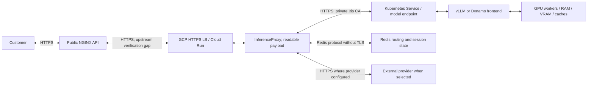
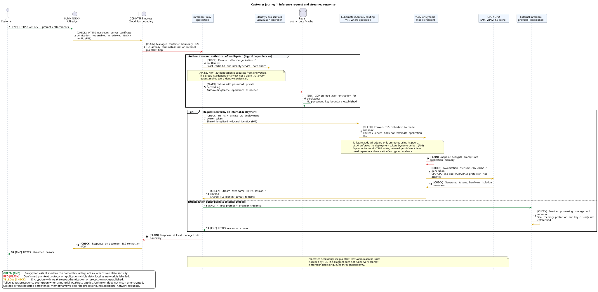
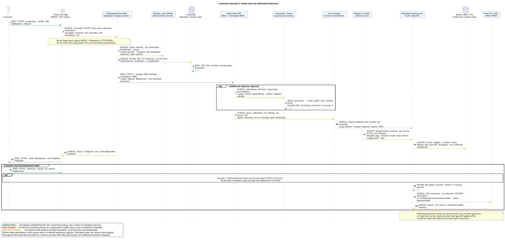
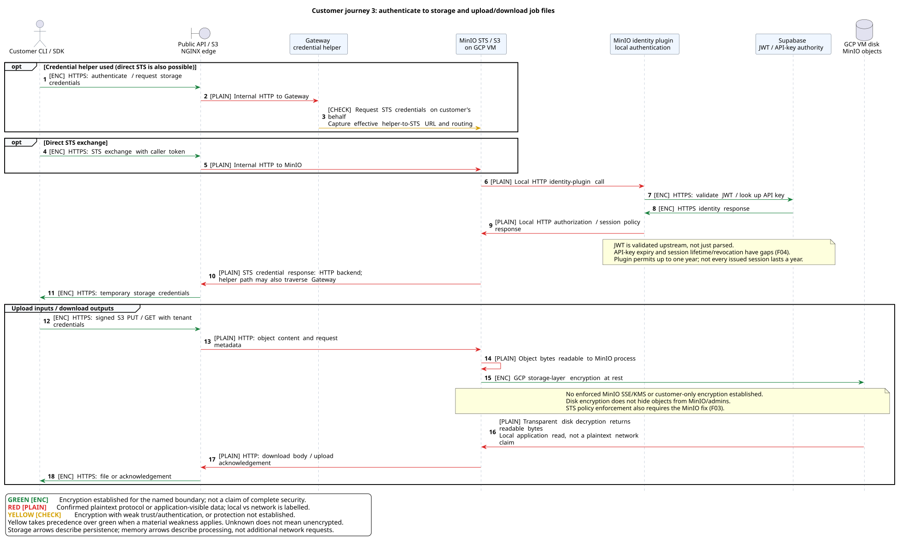
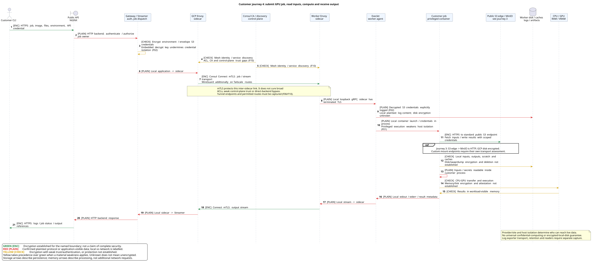
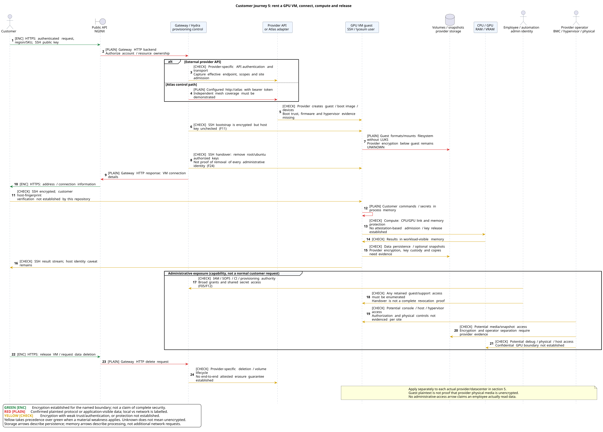
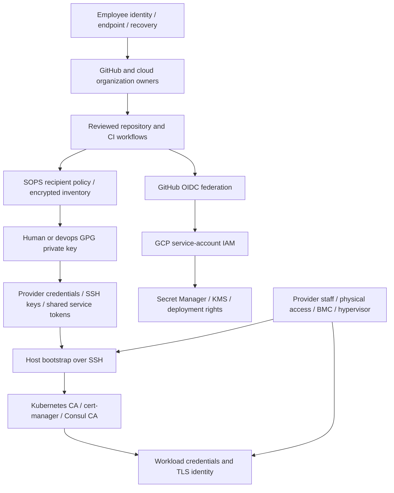

# Security audit — 2026-10-30

**Classification:** internal security-sensitive. Do not publish this report with infrastructure details or evidence bundles.

**Baseline:** repository commit `58376c9a1d45ae9766de6968735b04424e150bd9`, reviewed on 2026-10-30. Filename preserved exactly as requested: `security-audit-2026103.md`.

**Assumption:** the repository's effective production configuration matches production. Production overrides take precedence over module defaults. Alternative backends, examples, tests, and migration plans are not automatically active production services.

**Method:** source, infrastructure-as-code, deployment-template, workflow, and documentation review, with selected primary vendor security/lifecycle checks. No production changes, credential decryption, exploitation, network scanning, host interrogation, or physical inspection were performed. No customer payloads or private-key material are reproduced. The code graph reported a different-worktree index; findings were checked against files in this checkout instead of relying on graph relationships.

This is a broad repository-based security audit, not a penetration-test certificate or a complete software-composition scan. The production-equivalence assumption establishes declared settings; it cannot establish undeclared firmware versions, physical access practices, host patch installation, tenant placement, or hardware attestation. Those are explicit evidence gaps with collection tasks below, not assertions that every missing control is absent.

## 1. Executive assessment

**The platform cannot currently support an unqualified claim that customer workloads are strongly isolated, all customer-data paths are authenticated and encrypted, or the entire fleet is patched and protected against infrastructure administrators.** Public TLS and several newer identity controls are in place, but important trust boundaries remain weak.

The highest-priority issues are:

1. **Customer Execlet containers run privileged.** A customer workload must be treated as capable of compromising its worker host; shared-host tenant isolation is not credible on this path.
2. **Job storage credentials have a source-embedded decryption key and are logged after decryption.** Both the cryptographic boundary and logging boundary need immediate containment and credential rotation.
3. **The configured MinIO version predates a confirmed session-policy privilege-escalation fix.** The identity plugin also permits long-lived storage sessions and does not independently enforce API-key expiry.
4. **The legacy GitHub federation binding accepts workflows across the GitHub organization, while its service account can access project secrets.** Newer restricted deployment accounts coexist with this broader path.
5. **Network reach is broad.** Employee tailnet members, CI, and externally hosted workers have extensive VPC access; public firewall rules expose SSH and Consul ports. SSH provisioning explicitly disables host authentication.
6. **Inference encryption and authorization are different controls.** Model HTTPS is enabled, but Dynamo frontends lack equivalent model-endpoint bearer authentication. A shared, long-lived wildcard private key spans model workloads.
7. **Fleet assurance is incomplete.** There is no complete per-physical-site inventory tying machines and VMs to firmware, patch state, disk encryption, memory protection, destruction evidence, and accountable owners.

Useful controls already present include public HTTPS, TLS on Iris model endpoints including Dynamo frontends, per-deployment vLLM bearer tokens, GCP OIDC into Kubernetes, controller-specific Kubernetes roles, baseline Pod Security on Iris workloads, disabled service-account automount on the ordinary vLLM template, scoped newer deployment identities, encrypted-only private Cloud SQL, production SQL backups/PITR, SOPS encryption, and KMS support. Preserve and extend these rather than replace them wholesale.

### Evidence and severity conventions

| Label | Meaning |
|---|---|
| Confirmed | Explicit code/configuration establishes the condition under the production-equivalence assumption. |
| Inferred | Consequence follows from explicit configuration plus documented platform behavior; prerequisites are stated. |
| Gap | Repository cannot establish the control or its coverage. This is not proof of exploitation or absence. |
| Conditional | Applies when the named backend/template/component is used. |
| Critical | Credible host/platform compromise or broad customer-data exposure across a major trust boundary. |
| High | Material data exposure, privilege escalation, identity weakness, or serious unbounded security-control gap. |
| Medium | Defense-in-depth, lifecycle, observability, recovery, or assurance weakness with more limited/directly unproven impact. |

Severity describes risk, not an assertion that an incident occurred. Findings that combine gaps with confirmed settings say which is which. Proposed remediation deadlines start when this report is accepted; named roles below are proposed accountable owners, not assignments already made.

## 2. Scope, assets, and threat model

### Assets and actors

Customer data includes prompts, responses, multimodal inputs, KV caches, uploaded datasets/files, code/notebooks, model weights, fine-tuned checkpoints, execution environment variables, object-store credentials, VM disks/snapshots, and job logs. Account identity, API keys, billing metadata, routing/session state, and backups are separate sensitive classes.

Relevant actors are external attackers, malicious customers, compromised customer workloads, employees and former employees, compromised employee devices, CI jobs and dependency maintainers, cloud/provider administrators, datacenter remote-hands staff, BMC administrators, and attackers with stolen equipment or physical access.

Security objectives are confidentiality, integrity, availability, tenant separation, authenticated service identity, attributable privileged access, controlled geographic/provider placement, bounded data retention, and recoverability. Encryption against disk theft does not establish protection from a running privileged process. A private network does not establish tenant authorization. Dedicated scheduling does not establish confidential computing.

### Deployment and datacenter inventory established by the repository

| Site/provider boundary | Established production scope | Machine / VM responsibility | Evidence and unresolved scope |
|---|---|---|---|
| GCP product environment, `europe-west3`, default zone `europe-west3-a` | Public proxy/Gateway VMs, control-plane services, Cloud Run Iris, MinIO VM, Redis, Cloud SQL, networking and subnet routers | Google: facilities/physical hosts/hypervisor and managed-service infrastructure. Lyceum: IAM, VM guest OS, service configuration, data policies, customer application security | [Production configuration](infra/inventory/production/config.yml), [GCP modules](infra/terraform/_modules/gcp). A region/zone is not an exact building/rack inventory. GPU default zone is separately configured. |
| GCP platform environments | Build/artifact/state/automation infrastructure; distinct from product environment | Google infrastructure; Lyceum build and credential trust | [Platform production inventory](infra/inventory/platform-production/config.yml), [platform modules](infra/terraform/platform). Compromise can affect downstream product deployments. |
| Hetzner `fsn1` | TeamCity server and agents, Ubuntu 24.04, attached data volume | Hetzner facilities/hypervisor; Lyceum guest OS, CI execution, secrets, artifact integrity and backups | [Platform inventory](infra/inventory/platform-production/config.yml), [TeamCity servers](infra/terraform/_modules/hetzner/teamcity/servers.tf). Do not infer customer GPU placement here merely because CI is here. |
| Atlas-registered Lyceum/partner machines | Enabled H100/B200 supply in production inventory; Atlas registers partner and own machines | Physical owner/operator and hypervisor responsibilities need identifying for each actual machine; Lyceum controls admission/provisioning and workload policy | [GPU inventory](infra/inventory/production/supported_gpus.yml), [Atlas description](docs/wiki/docs/core/explanations/atlas.md), [Atlas adapter](infra/services/hydra-autoscaler/internal/providers/atlas). No auditable facility/rack/BMC/host-control inventory established here. |
| Verda, each actual location code | Enabled GPU supply and block-volume integration | Provider facilities/hypervisor/base image; Lyceum guest/workload settings and volume lifecycle | [GPU inventory](infra/inventory/production/supported_gpus.yml), [Verda adapter](infra/services/hydra-autoscaler/internal/providers/verda). Location support exists, but source examples such as FIN-01 are not evidence of deployed fleet location. |
| UpCloud, each actual zone | Enabled GPU supply, GPU Ubuntu template, provider metadata enabled for cloud-init | Provider facilities/hypervisor/image; Lyceum guest/workload controls | [UpCloud creation](infra/services/hydra-autoscaler/internal/providers/upcloud/client.go), [selection](infra/services/hydra-autoscaler/internal/providers/upcloud/instance_manager_backend.go). Zone selection considers availability/price; record effective tenant constraints and selected zones. |
| Prime Intellect and each underlying supplier/site | Enabled GPU supply; requests `secure_cloud` class | Marketplace plus underlying provider, then Lyceum guest/workload responsibility; every actual supplier must be identified | [Prime Intellect adapter](infra/services/hydra-autoscaler/internal/providers/primeintellect/client.go). The class label is a useful filter, not a physical-security, VM-isolation, or attestation proof. |
| Mithril / other alternate integrations | Code/credentials exist; Mithril entries in production GPU inventory are commented out | Conditional only | Inventory references do not establish current placement. Retained credentials still need an owner and revocation decision. |
| Proposed NICo / Run:AI datacenter | Migration design exists | Future physical operator, NICo machine lifecycle, cluster bootstrap, Run:AI admission, Iris and serving runtime responsibilities must be assigned | [Migration plan](model1-plan-20261029.md). Treat as a design acceptance gate, not as an already audited production facility. |

**Per-datacenter conclusion:** GCP region and Hetzner location are named; the complete set of physical GPU sites cannot be enumerated from the static inventory. A defensible audit must expand the provider rows into one row per physical site and one record per machine/VM using capture workstream C1. Do not label “Verda”, “Atlas”, or “Prime Intellect” as a single datacenter.

External inference providers, Supabase, GitHub, Tailscale, registries, telemetry destinations, payment/identity services, and DNS/certificate providers form additional trust boundaries. Their contracts, retention, employee access, and incident notification are not established by client code.

## 3. Data flows and encryption boundaries

### 3.1 Current inference path



The current Iris provider sends ordinary chat and streaming requests directly to deployment endpoints: [provider.go, lines 230–277](iris/inference_proxy/internal/provider/iris/provider.go). The older RabbitMQ/Redis inference-worker path remains in the repository and must be inventoried separately; it is not accurate to describe every current prompt as queued in RabbitMQ or stored in Redis.

Production selects HTTPS: [config.yml, line 39](infra/inventory/production/config.yml). Standard vLLM TLS is configured in [build.go, `serveOverTLS`](iris/deployment_controller/internal/k8smanifest/build.go); **Dynamo TLS is also configured**, through `serveFrontendOverTLS` in the same file. The Dynamo issue is missing endpoint authorization, not a blanket absence of frontend HTTPS. Its frontend-to-worker/event/cache links are a separate boundary requiring evidence.

### 3.2 Uploaded files and execution jobs

```mermaid
flowchart LR
    C[Customer CLI] <-->|HTTPS| S[Public S3 NGINX]
    S <-->|HTTP| M[MinIO on GCP VM]
    C -->|HTTPS job submission| A[Public API]
    A -->|HTTP| G[Gateway / Streamer host]
    G <--> GS[Consul Envoy sidecar]
    GS <-->|Consul Connect mTLS; VPN where routed| ES[Worker Envoy sidecar]
    ES <-->|Loopback gRPC without TLS| X[Execlet]
    X --> J[Customer container]
    J <-->|S3 filesystem via configured endpoint| S
```



The standard S3 endpoint is HTTPS, but arbitrary/custom mount URLs must be evaluated separately. Data is stored in MinIO on a GCP VM, not automatically in Google Cloud Storage. Storage credentials are envelope-encrypted for dispatch and decrypted by Execlet. That does not encrypt the uploaded objects at application level.

**Correction to the preliminary discussion:** Execlet's gRPC client uses `insecure.NewCredentials()`, but its deployed target is a loopback Consul upstream (`ubuntu-execlet.yml`, line 311). The repository installs Envoy sidecars and explicitly intends Connect mTLS between them. Therefore the inter-machine job path must not be described as naked gRPC across the network. Local application-to-sidecar hops remain plaintext; mesh CA, ACL, intentions, and bypass protection need hardening and verification. [Execlet deployment](infra/ansible/playbooks/ubuntu-execlet.yml), [Gateway sidecar](infra/ansible/playbooks/ubuntu-gateway.yml), [sidecar setup](infra/ansible/playbooks/roles/consul/tasks/create_services.yml), [Consul security model](https://developer.hashicorp.com/consul/docs/secure-mesh).

### 3.3 Traffic control matrix

| Flow | Protection established | Remaining concern |
|---|---|---|
| Customer → API/S3 public edge | TLS certificates on NGINX; HTTPS public endpoints | Endpoint/application authentication, request limits, and direct-origin exposure remain separate controls. HTTP redirect does not retroactively protect a request initially sent over HTTP. |
| Public NGINX → Iris/other HTTPS upstream | TLS and SNI configured | No `proxy_ssl_verify on` found in reviewed Ansible configuration. NGINX defaults verification off: encryption without authenticated upstream identity (F09). |
| GCP load balancer → Cloud Run service/container | Managed HTTPS edge/backend; container port is explicitly `h2c` | TLS terminates before application handling. `h2c` at the managed container boundary is not evidence of Internet plaintext; do not misclassify it as a public transport defect. |
| InferenceProxy → vLLM / Dynamo frontend | HTTPS and private CA trust configured | Shared wildcard private key; Dynamo does not enforce the per-deployment bearer token (F07/F08). |
| Dynamo frontend ↔ workers, ZMQ events, shared multimodal cache | Kubernetes networking; template includes `tcp://*:20080` for KV events and shared-memory transfer | No complete authenticated/encrypted internal graph-transport assurance established. Node locality does not cover future multi-node deployments. Capture payload types, sockets, graph identity, and tenant separation. |
| Proxy/Gateway → Redis | Password authentication; private service access | `redis://`, not TLS. Routing integrity, credentials, and any response-cache content depend on network access controls. RDB persistence is configured. |
| Queue worker ↔ RabbitMQ, when used | Username/password and private networking; some services have sidecars | Worker URL is `amqp://`; broker has TCP listener. Do not infer every client traverses mesh just because RabbitMQ has a sidecar. |
| NGINX → Gateway / MinIO | Internal HTTP (`gateway:8000`, `minio:9000`) | No application TLS on these hops; GCP infrastructure protections are not equivalent to endpoint authentication. |
| Gateway/Hydra → Atlas | Common configuration selects `http://atlas`; adapter attaches bearer token | Internal plaintext application protocol; establish actual proxy/mesh route rather than assume coverage. |
| Execlet ↔ Streamer | Loopback plaintext plus configured Connect mTLS sidecars | Consul control-plane trust and network policy/bypass exposure remain weak (F06/F10). |
| GCP ↔ external worker, where using Tailscale | WireGuard between Tailscale peers; GCP routes `100.64.0.0/10` through subnet routers | Tunnel ends at router/peer. Traffic beyond it needs its own application protection. Broad ACLs undermine lateral-movement containment. |
| Services → Cloud SQL | Private IP and `ssl_mode = ENCRYPTED_ONLY` | Encryption requirement does not prove all clients verify server hostname/CA; k3s DB URL uses `sslmode=require`. Separate query/data auditing gap. |
| GCP services → Kubernetes API | HTTPS plus Google OIDC audience and controller-specific RBAC | Integrity of distributed CA trust and powerful workload-creation rights must be protected. |
| Cluster autoscaler → Hydra gRPC | Server code requires and verifies client certificates, minimum TLS 1.2 | Capture issuing CA, client identity/authorization, expiry, rotation and deployed certificate inventory. |
| Human/automation → hosts | SSH encryption | Server host-key checking disabled in provisioning; shared keys and broad authority amplify interception risk. |
| Logs/metrics/backups → storage and SaaS | Depends on each exporter/destination | Sensitive logs are another copy of customer data; payload minimization, retention and reader access must be explicit. |

Sources: [proxy configuration](infra/ansible/playbooks/ubuntu-proxy.yml), [Cloud Run proxy](infra/terraform/_modules/gcp/iris/cloud_run_inference_proxy.tf), [Redis](infra/terraform/_modules/gcp/redis/instance.tf), [RabbitMQ configuration](infra/ansible/playbooks/roles/rabbitmq/templates/rabbitmq.conf.j2), [worker settings](iris/inference_worker/src/config.py), [Atlas URL](infra/inventory/common/config.yml), [SQL configuration](infra/terraform/_modules/gcp/cloud_sql/instances.tf), [k3s DB connection](infra/ansible/playbooks/roles/k3s_server/tasks/read_db_password.yml), [autoscaler mTLS](infra/services/hydra-autoscaler/internal/cagrpc/tls.go), [Tailscale routes](infra/terraform/_modules/gcp/tailscale/routing.tf).

### 3.4 Encryption at rest and in use

| Data/location | Established state | What this does not establish |
|---|---|---|
| GCP VM disks, managed databases and cloud storage | Google default storage-layer encryption protects stored customer content; MinIO's VM disk falls within that infrastructure boundary | Customer-exclusive keys, per-tenant cryptographic isolation, or protection from authorized running services. See [Google encryption-at-rest documentation](https://docs.cloud.google.com/docs/security/encryption/default-encryption). |
| MinIO objects | No MinIO SSE/KMS enforcement found in reviewed deployment; objects remain readable to MinIO and its privileged operators | GCP disk encryption is not client-side object encryption. Inventory bucket-specific settings before claiming object-level encryption. |
| Kubernetes Secrets / cluster datastore | No explicit k3s `secrets-encryption` or API encryption-provider configuration found | Disk encryption does not stop a database reader from reading Secret records. K3s supports explicit [Secret encryption](https://docs.k3s.io/security/secrets-encryption). |
| Customer execution environment variables | Fernet encryption before storage; startup fails when encryption key is absent | Gateway/key holders and job processes can decrypt them; key-version/rotation and backup handling need definition. [Implementation](app/src/app/models/encryption.py). |
| Job S3 credentials | RSA/AES envelope encryption in transit through job metadata | Embedded private key and credential logging negate the intended independent protection. |
| KMS application keys | Per-app key abstraction, annual default rotation, software default protection, destroy prevention | Mere presence of the library does not encrypt all application fields, MinIO objects, VM disks or GPU memory. [KMS module](infra/terraform/_modules/gcp/kms/kms.tf), [defaults](infra/terraform/_modules/gcp/kms/variables.tf). |
| Verda block volumes and customer VM filesystems | Provisioner formats and mounts devices directly; no guest LUKS layer in that role | Provider-side encryption and key ownership are not established by this code. [Volume preparation](infra/ansible/playbooks/roles/block_volumes/tasks/main.yml). |
| Hetzner CI data volume | Terraform creates ext4 volume with deletion protection | No guest encryption layer configured here; provider storage encryption, backups, and build-secret exposure require evidence. |
| Worker local disks, PVCs, caches, swap, crash dumps | Local-path/PVC and temporary-file use established; some cleanup exists | No fleet-wide encrypted-disk, encrypted-swap, secure deletion, or cryptographic erasure guarantee established. |
| CPU RAM / GPU VRAM / KV cache | Data is readable to the processing application; no enforced CPU/GPU confidential-computing or attestation admission policy identified | No claim of protection from host root, hypervisor/provider operators, physical probing, debug tools, DMA, or crash dumps. Hardware model names alone prove none of these. |

For confidential computing, the desired chain is verified boot and platform measurements → CPU TEE and GPU evidence appraisal → workload/image identity → authenticated channel → conditional key release. It must include CPU–GPU and any multi-GPU/multi-node path, approved firmware, replay prevention, debug-mode rejection and revocation. Memory encryption without attestation and isolated key release is insufficient. [NVIDIA threat model](https://docs.nvidia.com/confidential-computing/virtual-machines/threat-model).

### 3.5 Customer journeys — UML sequence diagrams

Read each diagram from top to bottom. These are **current-state logical sequences**, under the same repository-equals-production assumption as this audit. Optional branches are labelled; arrows representing storage, memory processing, identity dependencies or administrative capability are not additional network packets. The diagrams show the actors involved in each journey, grouping services where their exact call sequence varies. They do not assert that every optional service is called on every request.

**Arrow colours:** **green `[ENC]`** means encryption is established at the named boundary; **red `[PLAIN]`** means confirmed plaintext protocol or application-visible data; **yellow `[CHECK]`** means encryption has a material trust/authentication weakness, or protection has not been established. Yellow takes precedence when encryption alone would give a misleading assurance. A green arrow is not an overall security approval. A red local-memory arrow does not mean traffic crossed the Internet unencrypted, and yellow GPU/disk arrows do not prove encryption is absent. Text labels carry the same meaning without relying on colour.

The rendered SVGs can be opened individually for readable detail. Editable PlantUML sources are provided beside them, with a [shared legend/style](security-audit-2026103-assets/style.iuml). They were rendered locally; no audit contents were sent to a public diagram-rendering service.

#### 3.5.1 Inference customer: request to answer

The customer sends credentials and a prompt to the HTTPS edge. Authentication/organization resolution and Redis are distinct from model execution. Internal serving and policy-permitted external offload are alternative paths. Kubernetes routing and a VPN do not change where application TLS terminates. CPU/GPU memory is a separate boundary from encrypted transport.



[Open SVG](security-audit-2026103-assets/01-inference.svg) · [Download PNG](security-audit-2026103-assets/01-inference.png) · [PlantUML source](security-audit-2026103-assets/01-inference.puml). Evidence: sections 3.1–3.4; [proxy routing](infra/ansible/playbooks/ubuntu-proxy.yml), [InferenceProxy provider](iris/inference_proxy/internal/provider/iris/provider.go), [Cloud Run](infra/terraform/_modules/gcp/iris/cloud_run_inference_proxy.tf), [model TLS/auth configuration](iris/deployment_controller/internal/k8smanifest/build.go). Findings F06–F09 and F23 apply. Redis is a conditional cache dependency, not a claim that every prompt is persisted.

#### 3.5.2 Dedicated inference customer: provision, then use

Provisioning involves account authorization, deployment metadata, the Kubernetes control plane, capacity allocation, certificate issuance and artifact retrieval. The subsequent prompt follows the inference data path in 3.5.1; it is not routed through the provisioning controller. Dedicated capacity does not, by itself, protect plaintext from host or provider administrators.



[Open SVG](security-audit-2026103-assets/02-dedicated.svg) · [Download PNG](security-audit-2026103-assets/02-dedicated.png) · [PlantUML source](security-audit-2026103-assets/02-dedicated.puml). Evidence: [deployment manifests](iris/deployment_controller/internal/k8smanifest/build.go), [private CA template](infra/ansible/playbooks/roles/k3s_server/templates/iris-endpoint-tls.yaml.j2), [autoscaler mTLS](infra/services/hydra-autoscaler/internal/cagrpc/tls.go), [SQL encryption](infra/terraform/_modules/gcp/cloud_sql/instances.tf). Findings F07–F09, F11 and the storage, isolation and supply-chain findings apply. API compatibility routes are explicitly distinguished from controller HTTPS routes.

#### 3.5.3 GPU customer: storage authentication and files

This expands the shared storage path used before and after GPU execution. STS credentials authenticate S3 operations; they do not encrypt object contents. The HTTPS public endpoint, internal HTTP hop, local identity-plugin call and GCP disk encryption are separate boundaries. Credential-helper and direct-STS exchanges are alternatives, with the helper's effective internal endpoint requiring capture.



[Open SVG](security-audit-2026103-assets/03-storage.svg) · [Download PNG](security-audit-2026103-assets/03-storage.png) · [PlantUML source](security-audit-2026103-assets/03-storage.puml). Evidence: [NGINX S3/Gateway routing](infra/ansible/playbooks/ubuntu-proxy.yml), [identity plugin](infra/services/minio-identity-plugin/internal/handler/auth.go), [API-key lookup](infra/services/minio-identity-plugin/internal/supabase/supabase.go); findings F03/F04. A one-year maximum allowed by the plugin is not the lifetime of every issued session. Object-level encryption and operator access remain separate from GCP media encryption.

#### 3.5.4 GPU customer: managed execution job

This follows job submission through Streamer, the Consul sidecars and Execlet, then input retrieval, local storage, GPU processing and returned logs. The green inter-sidecar mTLS arrow does not erase the yellow control-plane trust issues or red local hops. The explicit credential log and privileged container are security defects even when network transport is encrypted.



[Open SVG](security-audit-2026103-assets/04-gpu-job.svg) · [Download PNG](security-audit-2026103-assets/04-gpu-job.png) · [PlantUML source](security-audit-2026103-assets/04-gpu-job.puml). Evidence: [Gateway deployment](infra/ansible/playbooks/ubuntu-gateway.yml), [Execlet deployment](infra/ansible/playbooks/ubuntu-execlet.yml), [Consul service setup](infra/ansible/playbooks/roles/consul/tasks/create_services.yml), [job credentials/logging](stream_execlet/job/job.go), [container privileges](stream_execlet/docker/container.go); findings F01/F02/F06/F10. S3 backend details are expanded in 3.5.3; provider/site-specific disk and hardware assurance remains subject to section 5.

#### 3.5.5 GPU customer: rented VM and administrative exposure

VM rental has a different access boundary from managed inference or container jobs. The customer receives guest access; provider provisioning, SSH host identity, retained administrative identities, volume encryption and hardware trust still matter. Administrative arrows describe possible authority that must be inventoried, not a claim that any person accessed a customer's data. These dependencies also apply to the hosts underlying the earlier journeys, although their guest handover differs.



[Open SVG](security-audit-2026103-assets/05-gpu-vm.svg) · [Download PNG](security-audit-2026103-assets/05-gpu-vm.png) · [PlantUML source](security-audit-2026103-assets/05-gpu-vm.puml). Evidence: [Atlas endpoint](infra/inventory/common/config.yml), [Hydra SSH](infra/services/hydra-autoscaler/internal/ssh/ssh.go), [volume preparation](infra/ansible/playbooks/roles/block_volumes/tasks/main.yml), [SSH handover](infra/ansible/playbooks/roles/lyceum_user/tasks/hand_over_ssh.yml); findings F05/F11/F12/F23/F24. Provider transport and physical/media controls must be captured per actual site, not inferred from a supplier name.

**Actor coverage and limits.** Across these five views, the customer-facing data and control paths include customer identities, public proxies, GCP managed ingress, application services, identity/organization authorization, metadata databases, caches, Kubernetes, autoscaling/provisioning, CA/signing services, mesh sidecars/control plane, artifact sources, object storage, worker agents, customer workloads, CPU/GPU memory, disks, employees/automation and provider operators. Billing/quota is grouped with authorization; it is not shown as receiving prompts. Legacy RabbitMQ inference workers, individual log exporters, backup destinations and every CI bootstrap step are not asserted to participate in these customer transactions: their controls remain in sections 3.3, 4–7 and the evidence-capture plan. Unknown internal hops are yellow, rather than invented as verified TLS. The diagrams therefore complement, rather than replace, the per-datacenter and root-of-trust inventories.

To regenerate the SVGs and PNGs locally with PlantUML 1.2026.2 and Java:

```sh
java -Djava.awt.headless=true -jar /path/to/plantuml.jar -tsvg -failfast2 security-audit-2026103-assets/*.puml
java -Djava.awt.headless=true -jar /path/to/plantuml.jar -tpng -failfast2 security-audit-2026103-assets/*.puml
```

## 4. Access, roots of trust, CA and key management

### 4.1 Trust map



This is the **effective administrative trust chain**, not a hardware-attested chain. A compromised repository owner, CI secret reader, provisioning SSH peer, Kubernetes administrator, or host administrator can undermine downstream workload trust unless an independently enforced boundary prevents it.

### 4.2 Identity and key inventory

| Authority/key | Current root and scope | Assessment / required management |
|---|---|---|
| Employee identities | `/people` drives groups; GitHub owners, GCP owners and Tailscale access have separate group labels | Positive declarative inventory. No complete evidence of phishing-resistant MFA, device posture, recovery approval, joiner/mover/leaver SLA or periodic review. Removing a profile does not invalidate already copied secrets. |
| GCP human privilege | Every `gcp-owner` member is assigned project `roles/owner` by the IAM module | Replace standing Owner with role-specific groups and time-bound elevation; separately constrain project/organization IAM changes and service-account impersonation. |
| SOPS | One creation rule spans environment config/account-password files; 12 named human recipients plus the devops role in the reviewed rule | Encryption exists, but no environment split or multi-person threshold is expressed. Verify actual envelopes' recipient sets; changing the rule alone does not rewrap existing files or revoke historical copies. Rotate underlying secrets on removal. |
| CI devops GPG private key | Imported into legacy deployment jobs; decrypts inventory secrets | High-value root shared with deployment automation. Reduce secret inventory accessible to any one workflow; prefer short-lived identity and resource-scoped fetches. |
| GitHub → GCP federation | Organization-owner condition; legacy CI binding can be organization-wide; deploy binding can be repository/ref-specific | Constrain immutable organization/repository IDs, protected ref/environment and workflow identity where supported. Scope the target account, not merely the token issuer. |
| SSH | Public keys in inventory and `/people`; private automation/provider keys encrypted in inventory | No SSH CA established. Host-key verification disabled. Prefer short-lived user/host certificates or verified provider fingerprints plus named accounts; secure break-glass path. |
| Tailscale | Human identities, administrator-controlled tags, OAuth enrollment clients and CI federation | Encrypted transport with broad role reach. Separate environment/operator/workload scopes, device posture, tag issuance, route approval and emergency revocation. |
| Public TLS / DNS | NGINX certificate files under Let's Encrypt; GCP managed certificates | DNS/ACME issuance and domain-account recovery are roots of trust. Inventory renewal, private-key readers and domain administrator authority. |
| Iris private CA | Self-signed ECDSA CA private key in cert-manager Kubernetes Secret; default CA lifetime 10 years | Root resides in the same administrative cluster as workloads. Protect signer namespace and key, separate issuance from deployment privilege, inventory trust-distribution paths. |
| Iris leaf key | One wildcard certificate/Secret for all deployment names; default leaf lifetime 5 years; mounted into model/worker containers | Workload compromise exposes an identity usable for other deployment names if traffic can be redirected. Use per-workload short-lived identity with renewal/reload. |
| Kubernetes API CA | Retrieved from server by Ansible, distributed to out-of-cluster clients via artifacts/Secret Manager | CA certificate is public, but its integrity is critical. Bootstrap over unverified SSH can poison trusted roots. Pin/verify bootstrap identity independently. |
| Consul | Shared gossip-encryption key; Connect sidecars; built-in/default CA path not fully governed in reviewed configuration | Gossip encryption is not RPC TLS, ACL authorization, or CA protection. Explicitly manage CA, ACL tokens, default-deny intentions, API/RPC TLS and service registration rights. |
| vLLM endpoint tokens | Derived per deployment; proxy and model configured with matching bearer token | Positive compartmentalization relative to a single leaf token; derivation root still has broad authority. Define rotation/generation changes and invalidate cached clients. |
| Dynamo frontend identity | TLS configured, but no equivalent bearer-token enforcement in builder | Network reach currently supplies authorization; must add authenticated proxy/sidecar or supported frontend authorization. |
| KMS | GCP IAM is root; software protection default, per-app encryption/decryption grants and annual rotation | Separate key administration from data access. Decide HSM/externally held keys based on threat model; rotate/re-encrypt data as necessary, since key rotation alone does not rewrap old ciphertext. |
| Application Fernet and job envelope keys | Environment-provided Fernet key; source-embedded RSA private key for jobs | Fernet fails closed at missing key, but lifecycle is incomplete. Replace the source-embedded key; never distribute a common decrypt-all private key to untrusted workers. |

Evidence: [.sops.yaml](.sops.yaml), [people directory contract](docs/wiki/docs/development/references/the-people-directory.md), [human IAM](infra/terraform/_modules/gcp/project_iam_members/main.tf), [federation](infra/terraform/_modules/gcp/github/wif.tf), [legacy CI permissions](infra/terraform/_modules/gcp/github/service_account.tf), [restricted deploy permissions](infra/terraform/_modules/gcp/github/deploy_access.tf), [Iris CA/leaf](infra/ansible/playbooks/roles/k3s_server/templates/iris-endpoint-tls.yaml.j2), [certificate lifetimes](infra/ansible/playbooks/roles/k3s_server/defaults/main.yml), [CA distribution](infra/ansible/playbooks/roles/k3s_server/tasks/fetch_ca_cert.yml).

### 4.3 RBAC and tenant boundaries

Kubernetes controller roles are namespaced and resource-specific, and Hydra's cluster role is limited to node `get/delete`: [k3s-server.yml, lines 64–176](infra/ansible/playbooks/k3s-server.yml). This is materially better than universal cluster-admin. However, workload-creation permission can indirectly obtain namespace Secrets by mounting them, even without direct Secret-read permission. Treat deployment controllers as namespace-privileged and constrain allowed Secret references, images, service accounts, host access and security contexts through admission policy.

Iris's namespace uses `baseline` Pod Security and runs model processes as root. Its ordinary vLLM template disables service-account automount; operator pods have additional hardening. The observability namespace is intentionally `privileged` for host metrics/log access. These exceptions need separate identities, image controls and host-data access review. Do not confuse `disable-network-policy: true` in k3s with proof that all network enforcement is impossible: Cilium is installed. The actual gap is no production workload default-deny/tenant-isolation policy found in the reviewed deployment paths.

The application has organization ownership and provider-allowlist mechanisms, but this audit did not exhaustively prove every route's authorization. Required negative tests include cross-organization deployment/VM/storage/log access, endpoint-direct calls, expired/revoked credentials, service-token misuse, SSRF through multimodal URLs/custom storage endpoints, provider-offload restrictions, and admission/billing bypass. Authentication by a trusted internal token must not imply unrestricted customer impersonation.

## 5. Machine and VM security by datacenter boundary

### 5.1 Common minimum host standard

Every machine record should identify physical/virtual status, tenant use, owner, facility/provider, serial or provider ID, management interfaces, image provenance, firmware/OS/runtime versions, boot integrity, disk/memory controls, network policy, monitoring, patch owner, and sanitization policy. Record inherited provider controls as provider attestations, not as host measurements.

Required controls include separate BMC/management networks, unique vaulted BMC credentials, MFA on management gateways, no public BMC, signed firmware, Secure Boot where compatible, measured boot, IOMMU for device assignment, restricted root/SSH, audited privilege elevation, authenticated package sources, controlled patch/reboot windows, runtime detection, restricted metadata access, and emergency isolation independent of a compromised workload OS.

### 5.2 Per-site/provider assessment

| Boundary | Host / physical security | VM / workload security | Disk, RAM and patch status | Action before declaring compliant |
|---|---|---|---|---|
| GCP product/platform | Facility/host controls inherited from Google; public VM IPs and broad legacy ingress are explicit. No explicit Shielded/Secure Boot policy found in reviewed VM modules | Guest/service responsibility remains ours; Cloud Run managed isolation differs from VM and customer-container isolation | GCP at-rest encryption established; confidential RAM policy not established. Guest package state not fixed by image family or `state: present` | C1/C2 inventory, F05/F06/F11/F16; enforce VM security options after GPU compatibility tests. Google does not enable Secure Boot by default: [documentation](https://docs.cloud.google.com/compute/shielded-vm/docs/modifying-shielded-vm). |
| Hetzner fsn1 CI | Empty inbound firewall resource is a positive deny-by-default design; access via Tailscale. Physical/operator access evidence absent | CI agents process build inputs; compromise can contaminate artifacts or access credentials even without customer data stored intentionally | Ubuntu 24.04 selected; TeamCity 2026.2.1 configured; attached ext4 data volume lacks guest encryption in Terraform. No complete CI host/backup/patch attestation | Isolate untrusted PR builds from trusted release signing/deploy credentials; capture facility/host assurances, volume encryption, agent reset, backups and patch evidence. |
| Atlas, each registered site | Facility, BMC, physical access and host/hypervisor implementation not available in this repo. Registration is not an attestation | Distinguish bare metal, VM and container capacity. Provider/host-root visibility survives customer SSH handover | Disk encryption, boot chain, firmware, hypervisor patches and confidential memory unknown per machine | Require site dossier and asset attestations before admission; quarantine unknown sites for sensitive customer workloads. |
| Verda, each selected location | Provider physical/host controls require evidence | Managed worker VMs join our trust domain; customer VMs are handed to customer. Provider hypervisor/console authority remains | Block storage created/mounted; no guest encryption layer established. Driver image supplied by provider, not centrally patched by GPU Operator | Collect per-location contract/control evidence, actual image/driver/kernel IDs, encryption/key ownership, snapshot/deletion rules and maintenance SLA. |
| UpCloud, each selected zone | Provider facilities/hypervisor trusted; no physical audit evidence here | Root bootstrap through provider SSH key; metadata enabled for cloud-init. Separate customer VM from managed worker policies | AI/ML Ubuntu template is a reference, not patch proof; disk/RAM assurances need provider and guest evidence | Restrict metadata/credential reach from customer containers, validate template provenance, collect per-zone protection and destruction evidence. |
| Prime Intellect, each underlying supplier/site | `secure_cloud` filter establishes a selection label only | Isolation depends on actual supplier and whether capacity is VM/container/bare metal | No uniform firmware/kernel/disk/RAM guarantee derived from marketplace API | Require underlying supplier and facility IDs plus evidence; reject ambiguous capacity for workloads requiring strong isolation/location guarantees. |
| New NICo / Run:AI site | Must establish BMC, rack access, secure provisioning, inventory, firmware lifecycle and disposal | Run:AI scheduling/quotas do not replace a security boundary for arbitrary customer code | CPU/GPU attestation, disk key release, network/RDMA protection and patch lifecycle must be acceptance criteria | Complete the site acceptance gate in section 10 before public admission. Existing migration plan is not security evidence. |

### 5.3 Customer VM handover

[lyceum-vm-setup.yml](infra/ansible/playbooks/lyceum-vm-setup.yml) validates a customer SSH key, creates the `lyceum` user, prepares volumes, and hands over SSH last. [hand_over_ssh.yml](infra/ansible/playbooks/roles/lyceum_user/tasks/hand_over_ssh.yml) removes root/ubuntu authorized-key files, disables root SSH and password authentication. The customer gets passwordless sudo through [sudoers.lyceum](infra/ansible/playbooks/roles/lyceum_user/files/sudoers.lyceum).

These are useful guest-access controls, **not proof that Lyceum/provider administrators cannot access a VM**: provider console, disk snapshots, image agents, hypervisor, BMC and rescue modes remain possible authorities. The authorized-key task is additive rather than explicitly exclusive for the `lyceum` account; inspect all effective keys, authorized-key commands, SSH CA trust, sshd includes, metadata injection and alternative users. State customer responsibility for guest patching after handover, provider responsibility below the guest, and the agreed support/break-glass process. Do not silently leave managed-worker network credentials inside handed-over VMs.

### 5.4 Physical security and lifecycle evidence required per facility

Collect an accountable facility operator, exact site jurisdiction, in-scope audit report and date, visitor/remote-hands procedure, access-list approval and revocation, badge/biometric controls, rack/cage access separation, CCTV/log retention, BMC/console access records, tamper/asset controls, power/fire/environmental resilience, supply-chain receipt checks, RMA handling and media destruction attestations. Review scope and exceptions of third-party reports; a provider-wide certification does not automatically cover a particular reseller site or service.

For owned/colocated equipment, collect machine serials, rack positions, BMC address/firmware and named administrators. For provider VMs, obtain provider commitments/evidence instead of claiming to inspect inaccessible firmware. For reseller capacity, require both reseller and actual operator evidence.

## 6. Findings register

| ID | Severity / evidence | Finding and impact | Remediation / closure evidence |
|---|---|---|---|
| F01 | **Critical — Confirmed** | Execlet sets `Privileged: true` for customer containers. Customer code has an unacceptable host-compromise boundary; other workloads and worker credentials are exposed to the resulting host authority. [container.go, line 394](stream_execlet/docker/container.go) | Stop shared-host execution of untrusted privileged jobs; isolate affected capacity. Remove privileged mode, restrict devices/capabilities/mounts, and use an appropriate VM/sandbox boundary or dedicated disposable hosts for arbitrary customer code. Close with negative isolation tests and admission enforcement. |
| F02 | **Critical — Confirmed** | S3 envelope-decryption private key embedded in application source; plaintext credentials explicitly logged after decrypt. Root/job logs also include whole job objects. [job.go, lines 21, 458, 486, 495](stream_execlet/job/job.go) | Treat key as exposed to source/binary readers. Stop credential logging; inventory logs/artifacts and sessions; revoke/rotate affected credentials and replace envelope design with scoped short-lived worker identity. Preserve necessary incident evidence before controlled deletion. Removing the source string alone is insufficient. |
| F03 | **High — Confirmed version; conditional exploit path** | MinIO pinned to `RELEASE.2025-07-18T21-56-31Z`, earlier than GHSA-jjjj-jwhf-8rgr fix. Restricted STS/service-account policy bypass is relevant to an STS-based storage design; exact allowed operations determine exploitability. [vars.yml](infra/ansible/vars.yml) | Move to a supported distribution/build with this and subsequent applicable fixes; inventory newly created service accounts and test policy boundaries. The 2025 fix is a minimum baseline, not proof of full 2026 coverage. See vendor references in section 7. |
| F04 | **High — Confirmed** | MinIO identity plugin returns a one-year maximum validity; API-key lookup checks active flag but not expiry. JWT path calls Supabase for authentication, then does not bound storage session lifetime to token expiry. [auth.go, lines 81–87, 149–164](infra/services/minio-identity-plugin/internal/handler/auth.go), [API-key lookup](infra/services/minio-identity-plugin/internal/supabase/supabase.go) | Bound sessions to the minimum of credential expiry, job lifetime and policy limit; independently validate API-key expiry; implement revocation. Test direct STS access. Do not misreport the JWT parser as a standalone signature bypass: upstream Supabase validation is present. |
| F05 | **Critical — Confirmed configuration chain** | Legacy GCP CI federation defaults to any workflow in the GitHub organization; its service account has project-wide Secret Manager accessor and artifact writer roles. Product Terragrunt does not set `ci_ref`. [WIF](infra/terraform/_modules/gcp/github/wif.tf), [CI IAM](infra/terraform/_modules/gcp/github/service_account.tf), [product inputs](infra/terraform/gcp/github/terragrunt.hcl) | Restrict trusted repo/ref/workflow identities, then scope secret and registry access per pipeline. Remove legacy decrypt-all credentials from routine builds. Close with a negative token-exchange test from an unrelated repo/ref and verified denied secret reads. |
| F06 | **High — Confirmed** | Tailnet people group reaches VPC/private-service ranges across environments on all ports; external workers and CI have broad environment VPC reach. Legacy GCP rules allow Internet SSH and Consul DNS/RPC/gossip/sidecar ports. [ACL](infra/terraform/tailscale/main.tf), [legacy firewall, lines 90–202](infra/terraform/_modules/gcp/legacy/main.tf) | Build least-privilege flow allowlists, remove public control-plane ingress, separate human/admin/CI/tenant paths, and test denied lateral movement. Account for all allow rules and public IPs; presence of a stricter rule elsewhere does not cancel a permissive one. |
| F07 | **High — Confirmed** | Iris CA lives in cluster Secret; 10-year CA and 5-year shared wildcard leaf defaults. Leaf private key is mounted into workload containers; renewal requires recycle. [CA template](infra/ansible/playbooks/roles/k3s_server/templates/iris-endpoint-tls.yaml.j2), [defaults](infra/ansible/playbooks/roles/k3s_server/defaults/main.yml), [mounting](iris/deployment_controller/internal/k8smanifest/build.go) | Per-workload short-lived certificates, protected signer, constrained issuance, automated renewal/reload and emergency rotation drill. Validate CA distribution integrity. Shared leaf compromise permits impersonation if an attacker can redirect/reach traffic; it is not automatic decryption of all captured TLS sessions. |
| F08 | **High — Confirmed** | Dynamo builder explicitly omits `VLLM_API_KEY` enforcement; graph answers requests reaching its Service. HTTPS is configured but authenticates the server, not caller entitlement. [build.go, lines 464–468 and `serveFrontendOverTLS`](iris/deployment_controller/internal/k8smanifest/build.go) | Add supported auth or an authenticated gateway/sidecar and restrict network ingress to it. Close with denied unauthenticated, cross-tenant and direct-worker requests. Preserve streaming and health behavior. |
| F09 | **High — Inferred from explicit config and documented default** | NGINX HTTPS upstream routes set SNI/name but do not enable certificate verification in reviewed deployment config. [proxy](infra/ansible/playbooks/ubuntu-proxy.yml), [NGINX default](https://nginx.org/en/docs/http/ngx_http_proxy_module.html#proxy_ssl_verify) | Enable upstream verification with correct trust bundle, hostname and depth. Test untrusted/expired/wrong-name certificates fail closed. Encryption without verification leaves an active interception risk. |
| F10 | **High — Confirmed declarations / configuration gap** | Consul config supplies gossip encryption but no explicit ACL, RPC/API TLS verification or default-deny service intentions. Server API binds all interfaces; public RPC/gossip rules increase exposure. Sidecar mTLS does not secure the control plane by itself. [Consul config](infra/ansible/playbooks/roles/consul/templates/consul.hcl.j2) | Explicit secure bootstrap, ACL tokens, service-registration restrictions, RPC/API TLS, protected CA and default-deny intentions; block direct backend bypass. Validate Connect chain and denied unauthorized registrations. |
| F11 | **High — Confirmed** | Ansible host-key checking is disabled globally and Hydra uses `ssh.InsecureIgnoreHostKey()`. [ansible.cfg](infra/ansible/ansible.cfg), [Hydra SSH](infra/services/hydra-autoscaler/internal/ssh/ssh.go) | Verified provider host-key bootstrap or host CA, strict checking, controlled replacement/rekey procedure. Include CA-fetch steps in the fix; otherwise a bootstrap MITM can replace future trusted roots. |
| F12 | **High — Confirmed broad access / lifecycle gap** | Standing GCP Owner grants and broad SOPS recipient coverage create large human/automation compromise radius. Devops decryption key is imported by CI. [IAM](infra/terraform/_modules/gcp/project_iam_members/main.tf), [SOPS](.sops.yaml), [workflow](.github/workflows/release-infra-deploy.yml) | Role-specific/JIT access, environment-separated secrets, MFA/device controls, key custody, quarterly access review and tested offboarding with underlying-secret rotation. |
| F13 | **High — Confirmed** | Internal Gateway/MinIO HTTP, Redis without TLS and legacy AMQP leave application-level plaintext on internal links. [proxy](infra/ansible/playbooks/ubuntu-proxy.yml), [Redis URL](infra/terraform/_modules/gcp/iris/cloud_run_inference_proxy.tf), [worker](iris/inference_worker/src/config.py) | TLS/mTLS or verified mesh coverage for each hop; authenticated peers, no insecure fallback; restrict listeners to expected callers. Loopback and managed Cloud Run container hops need separate threat classification. |
| F14 | **High — Gap with explicit datastore configuration** | Kubernetes Secret envelope encryption and API audit logging not declared in reviewed k3s templates. Cloud SQL at-rest encryption does not replace API-object encryption/access audit. | Enable supported k3s Secret encryption, rotate/rewrite existing Secrets and protect key backups; configure metadata-focused API auditing and external retention. [k3s configuration](infra/ansible/playbooks/roles/k3s_server/templates/config.yaml.j2), [API args](infra/ansible/playbooks/roles/k3s_server/templates/kube-apiserver.yaml.j2). |
| F15 | **High — Confirmed exposure / policy gap** | Model workloads run root and enable `--trust-remote-code`; shared namespace and no reviewed production default-deny workload policy. Shared wildcard keys and worker Redis credentials increase consequences of model-code compromise. [builder](iris/deployment_controller/internal/k8smanifest/build.go), [namespace policy](infra/ansible/playbooks/k3s-server.yml) | Allowlist and pin model code/revisions, restrict egress/metadata access, scope secrets per workload, enforce admission and tenant isolation. Verify all DGD-rendered pods as well as StatefulSets; chart-generated defaults are not evidence. |
| F16 | **High — Gap** | No complete per-site physical/BMC/firmware/hypervisor/boot attestation inventory; no enforced confidential CPU/GPU memory admission found. | Capture C1/C2/C6; choose documented trust tiers and block sensitive workloads on unknown/unqualified capacity. Do not promise protection from host/provider administrators without an attested design. |
| F17 | **High — Gap / confirmed missing guest layer** | Non-GCP worker disks, block volumes, CI data, snapshots, swap and caches lack a demonstrated uniform encryption/erasure control. Volume preparation formats raw filesystems. | Establish provider guarantees and guest/host encryption with external key custody; lifecycle deletion and crypto-erasure evidence; include clones, snapshots, swap and crash dumps. Test recovery before rollout. |
| F18 | **High — Confirmed lifecycle weakness** | Control-plane unattended upgrades disabled; k3s roles fail when an installed version differs and say rolling upgrades are not implemented. GPU Operator leaves drivers to provider image; CUDA role checks `nvidia-smi` success rather than enforcing security version. | Implement tested rolling maintenance, drain/reboot and rollback; per-provider driver/firmware baseline and patch SLA; immutable rebuilt images where feasible. [server playbook](infra/ansible/playbooks/k3s-server.yml), [installer](infra/ansible/playbooks/roles/k3s_server/tasks/install.yml), [GPU operator](infra/ansible/playbooks/roles/k3s_server/templates/gpu-operator.yaml.j2), [driver role](infra/ansible/playbooks/roles/cuda/tasks/install_cuda.yml). |
| F19 | **High — Confirmed declarations / assurance gap** | Mutable image references remain (including production inference-worker `latest`); legacy Dockerfiles use mutable base tags, while newer base images are digest-pinned. No complete mandatory SBOM/signature/vulnerability admission path established in reviewed workflows. | Emit immutable release manifests, signed provenance and SBOMs; scan built artifacts and require allowed signatures/digests at deployment. Scope exception expiry and rollback. [production inventory](infra/inventory/production/config.yml), [legacy Dockerfile](iris/inference_worker/Dockerfile), [new Dockerfile](infra/docker/go-service/Dockerfile). |
| F20 | **Medium — Confirmed / coverage gap** | Logs can contain job objects, credentials, code and identity details; Ansible logs are uploaded as artifacts. Cloud SQL audit config adds ADMIN_READ, not a comprehensive data-access trail. | Remove payload/secrets from routine logs, apply field allowlists and redaction, isolate immutable audit logs with reader audit, define retention/deletion and enable required data-access events. [job logging](stream_execlet/job/job.go), [workflow artifacts](.github/workflows/release-infra-deploy.yml), [SQL auditing](infra/terraform/_modules/gcp/cloud_sql/auditing.tf). F02 remains critical regardless of this broader logging severity. |
| F21 | **Medium — Confirmed positive controls / recovery gap** | Production SQL backups/PITR and deletion protection exist; SQL is zonal. No complete cross-store restore/compromise-recovery and MinIO/worker-data retention evidence established. | Define service RPO/RTO, immutable/separate-account backups, key recovery, ransomware isolation and restore drills. Include state, CA, IAM, SOPS recovery, objects and provider volumes. [SQL](infra/terraform/_modules/gcp/cloud_sql/instances.tf), [state bucket](infra/terraform/_modules/gcp/platform_state_bucket/state_bucket.tf). |
| F22 | **Medium — Confirmed configuration** | Repository rules do not dismiss stale approvals or require last-push approval; privileged automation uses an internal action at mutable `@main`. Other actions are SHA-pinned. | Ensure security-sensitive changes are reviewed on final content; pin internal actions, constrain bypasses and require separation of build/release approval. [rulesets](infra/terraform/_modules/github/repositories/rulesets.tf), [release workflow](.github/workflows/release-infra-deploy.yml). |
| F23 | **High — Gap** | Provider/physical-site qualification and permitted customer-data locations are not bound to a complete measured fleet inventory. External inference offload adds another data destination. | Record actual site/supplier and tenant-approved processors; make admission and fallback fail closed on unknown/disallowed destinations; verify no cross-provider/site fallback bypass. |
| F24 | **Medium — Confirmed / boundary gap** | Customer VM SSH handover removes root/ubuntu keys but is not a complete admin-revocation proof; `lyceum` key insertion is not exclusive, and provider/hypervisor access remains. | Attest effective guest access, remove managed-worker identities from customer VMs, document customer/provider patch obligations and audited break-glass authority. [handover](infra/ansible/playbooks/roles/lyceum_user/tasks/hand_over_ssh.yml). |

### Compounded attack paths to prioritize

- Malicious customer job → privileged Execlet container → worker-host authority → local credentials/tailnet identity → broad private-service reach. F01, F02 and F06 compound; fixing only TLS does not remove this path.
- Compromised GitHub workflow in another organization repository → legacy WIF account → project secrets/artifact writes → production deployment/data authority. F05, F12 and F19 compound.
- Compromised model code → shared wildcard leaf key and workload credentials → internal endpoint impersonation or direct unauthenticated Dynamo access where reachable. F07, F08 and F15 compound.
- Compromised provisioning network/host identity → bootstrap secrets or substituted CA → persistent trust in attacker-controlled endpoint. F11 and F07 compound.
- Stolen/leaked storage credential → long session/revocation gap → vulnerable session-policy enforcement. F02–F04 compound; exact policy permissions still determine scope.

## 7. Is the stack up to date?

**Not demonstrably across the fleet, and at least one configured component is behind a confirmed security fix.** A version pin is evidence of intended version, not evidence of current support or absence of vulnerabilities. Conversely, an old-looking version may include vendor backports; compare exact package release and vendor advisories, not version age alone.

| Layer/component | Repository evidence | Assessment as of 2026-10-30 |
|---|---|---|
| MinIO server | `RELEASE.2025-07-18T21-56-31Z` in `infra/ansible/vars.yml` | Behind the 2025-10-15 session-policy fix. Official repository is archived and has subsequent 2026 advisories: support/distribution decision required, not merely a one-off bump. |
| Legacy Alpine runtime images | `alpine:3.21` in Iris Go-service Dockerfiles | Official main support ends **2026-11-01**, two days after audit date. Current patch digest is not fixed by this tag. Migrate active images before support expiry; do not call it already EOL on audit date. |
| k3s control plane / agents | Role defaults `v1.36.1+k3s1`; separate old `ubuntu_k8s_k3s_version: v1.33.4-rc1+k3s1` variable exists | Map every deployment path to effective pin; do not report the old variable as the active cluster version without a consumer. Full supported-release/advisory comparison remains open. Rolling upgrade automation is explicitly missing. |
| Cilium / cert-manager / external-secrets / KEDA | Defaults `1.19.4` / `1.21.1` / `0.10.7` / `2.20.2` | Pins are visible, but dependency/image digests and current advisory coverage were not comprehensively scanned. Chart version alone does not enumerate every installed image. |
| GPU Operator / drivers | `v25.3.4`; `driver.enabled: false` | Provider image owns host driver version. No complete per-node driver/firmware inventory or enforced minimum demonstrated. |
| NVIDIA Container Toolkit | L40S-specific `1.17.9-1`; other path not fixed to that version | Do **not** incorrectly attribute the July 2025 flaws fixed in 1.17.8 to 1.17.9. Check all later advisories and actual operator-managed toolkit versions before declaring current. |
| CUDA toolkit | `12.9` family | Patch/update number not established by family setting. NVIDIA's September 2025 bulletin distinguishes 12.9 Update 1 and 13.0 fixes; collect exact packages and affected functionality. |
| Consul / Envoy / Tailscale | `1.22.0` / `1.36.2` / `1.94.2` | Known pins, not a comprehensive current-security attestation. Include server/client/proxy version compatibility and advisory scan. |
| TeamCity / CI guest | `2026.2.1`, Ubuntu 24.04 | Intended versions identified; OS package revision, plugins, JVM, build-agent images and applicable advisories require capture/scanning. |
| Go / Python base | Workspace Go `1.26.5`; modules vary; newer Python base pinned to `3.13.7-slim` digest | Need compiled binary toolchain metadata and SBOM, not only `go.mod` or lockfiles. Digest pinning gives reproducibility but needs scheduled security rebuilds. |
| Serving runtime / model code | Multiple vLLM families, Dynamo runtime/operator versions, local patches, remote model code | Scan and attest each final model image plus local patches/model revision; one generic vLLM version is insufficient. |
| Host kernel / containerd / Docker / runc / OpenSSH / OpenSSL | Mixed role-installed packages and provider images | Running kernel, installed kernel, package changelog/backport status and pending reboot not established. |
| BIOS/UEFI / BMC / microcode / GPU VBIOS / NIC / NVSwitch / NVMe / hypervisor | No complete machine-specific inventory found | Cannot determine currency. Obtain measured inventory or dated provider assurance per physical site. Treat inability to attest as a placement/control gap. |

Primary vendor checks, accessed 2026-10-30:

- [MinIO GHSA-jjjj-jwhf-8rgr](https://github.com/minio/minio/security/advisories/GHSA-jjjj-jwhf-8rgr): restricted STS/service-account policy bypass; patched release `RELEASE.2025-10-15T17-29-55Z`. Applicability to the configured older release is established; no exploit was attempted.
- [MinIO advisory index](https://github.com/minio/minio/security/advisories): repository archive and later advisories warrant a full supported-build assessment. No claim that every listed advisory applies to our enabled features.
- [Alpine release support](https://www.alpinelinux.org/releases/): 3.21 main support end 2026-11-01; community-package support differs.
- [NVIDIA July 2025 Container Toolkit bulletin](https://nvidia.custhelp.com/app/answers/detail/a_id/5659): affected toolkit through 1.17.7, fix 1.17.8, with mode-specific qualifications.
- [NVIDIA September 2025 CUDA bulletin](https://nvidia.custhelp.com/app/answers/detail/a_id/5661): use exact toolkit update and component applicability when triaging the 12.9 family.
- [NVIDIA product security](https://www.nvidia.com/en-us/security/): source for ongoing driver, firmware, operator and toolkit advisory intake.

No full CVE census, authenticated fleet scan, vendor firmware comparison, or locked-dependency SCA run was completed in this audit. C5 below supplies that missing evidence. Until then, unlisted components are **unassessed for currency**, not “clean.”

## 8. Plan A — capture and reconcile the security state

This plan resolves uncertainty without waiting to fix the confirmed critical issues. Use approved read-only collectors with least privilege. Do not put raw production Secrets, kubeconfigs, private keys, Terraform state bodies, customer prompts or credential-bearing process arguments into Git or CI artifacts. Keep restricted evidence in a separate encrypted, access-logged repository/bucket; the Markdown report holds references, hashes and conclusions only.

| Workstream | Proposed owner / target | Collection and deliverable | Acceptance criteria |
|---|---|---|---|
| C1 — Asset and site census | Platform + provider operations; 3 business days | Join cloud/provider instances, Atlas registrations, Kubernetes nodes/pods, Hydra DB records, volumes/snapshots and CMDB. Include GCP product/platform, Hetzner fsn1, each Verda/UpCloud location and each Prime Intellect underlying supplier. Produce one record per site/host/VM and unmapped exceptions. | 100% active customer-serving assets and CI/control-plane assets have owner, site/provider ID, tenant role and image identity; no unknown site silently accepted. |
| C2 — Machine/VM measurements | SRE + datacenter operator; 7 days | Read OS/kernel/package inventories, boot ID/time, pending reboot, container runtime, NVIDIA stack, firmware/serial inventory, Secure Boot/TPM/IOMMU and BMC state. For VMs, distinguish guest observation from provider assertion. | Every asset has timestamped measurements or a named, expiring provider-evidence exception. No “latest” or successful `nvidia-smi` accepted as patch evidence. |
| C3 — Access and roots of trust | Security + identity/platform owners; 5 days | Export IAM bindings/inheritance, service-account impersonation/key metadata, GitHub org/repo/environment rules, WIF predicates, SOPS recipient metadata, tailnet ACL/device/tag ownership, SSH effective access, Kubernetes RBAC/admission, CA/key public metadata and distribution paths. | Effective privilege graph answers who can read customer data, deploy code, issue identity, change trust and recover keys. Every privileged principal has owner, purpose, expiry/review date and revocation procedure. |
| C4 — Flow verification | Network/SRE + service owners; 5 days | Compare rendered configs, DNS, routes, firewall policies, mesh config, listeners and selected synthetic connections. Test TLS hostname/CA validation and direct-backend rejection; capture only synthetic traffic where packet capture is necessary. | Every flow in section 3 has encryption endpoints, authentication, authorized callers, route, protocol and tested deny case. No ambiguous “VPN means encrypted everywhere” entries. |
| C5 — Vulnerability and lifecycle census | Release engineering + SRE; 7 days | Produce SBOMs for actual binaries/images, exact OS packages and chart-rendered images; scan with current vendor/OSV/security feeds. Collect firmware advisories per hardware SKU. Include embedded runtimes, Java/plugins, custom patches and model code. | Version/build → advisory → applicability → fix/mitigation → owner/SLA recorded for every asset. Critical known-exploited exposure has immediate containment. Unsupported components have migration dates. |
| C6 — Storage, memory and physical assurance | Security + provider/datacenter owner; 10 days | Disk/volume/snapshot/backup encryption and key ownership; swap/core-dump policy; guest/host CPU and GPU CC state; attestation chain if claimed. Obtain physical-site and hypervisor control evidence, access logs, RMA/disposal guarantees. | Separate “encrypted”, “isolated”, “attested”, and “provider asserted”; every sensitive data location has lifecycle/retention and threat-model coverage. |
| C7 — Detection, retention and recovery | SRE + incident lead; 10 days | Inventory audit/log sinks and readers, alert rules, retention, backup policies, restore evidence and incident runbooks. Search credential exposure using restricted tooling/redacted output. | Synthetic access/secret-read/role-change events reach independent audit storage; critical alerts page a named on-call; restore drill meets agreed RPO/RTO. |
| C8 — Tenant/application negative tests | Application security + product owners; 10 days | Synthetic two-tenant tests for object/VM/job/deployment/log access, expired/revoked credentials, direct model calls, metadata/SSRF boundaries, offload restrictions, concurrency/admission and cancellation. | Denials demonstrated without touching real customer data. Results linked to route/backend/image versions; failures become tracked findings. |

### Suggested evidence record

```yaml
asset_id: provider-scoped-stable-id
observed_at: timestamp-with-timezone
source_commit: 58376c9a1d45ae9766de6968735b04424e150bd9
owner_role: named-accountable-team
environment: production
provider: provider-name
underlying_operator: identified-operator-or-unknown
site_id: facility-or-provider-zone-id
kind: physical-host-or-vm-or-managed-service
parent_host_id: known-id-or-provider-not-disclosed
workload_role: customer-vm-or-worker-or-control-plane-or-ci
tenant_isolation: documented-boundary
image_digest: immutable-reference-or-gap
versions:
  running_kernel: measured-or-gap
  firmware_manifest_ref: restricted-evidence-reference
  sbom_ref: restricted-evidence-reference
controls:
  boot_integrity: measured-or-provider-asserted-or-unknown
  disk_encryption: scope-and-key-owner
  memory_protection: cpu-gpu-link-scope-and-attestation-status
  admin_access_ref: effective-privilege-evidence
  network_policy_ref: rendered-policy-evidence
last_patch_at: timestamp-or-unknown
reboot_required: measured-or-unknown
evidence_hash: sha256-of-restricted-bundle
exception: owner-expiry-and-compensating-control-or-none
```

Safe collector examples include package/version metadata (`uname -r`, OS release, package-manager inventories, `go version -m` for deployed binaries), narrowly scoped `nvidia-smi` queries, disk topology (`lsblk`), effective SSH settings, Kubernetes node image/version fields and RBAC metadata, cloud asset/IAM exports, and public certificate subject/SAN/issuer/expiry. Firmware/BMC queries require a separate management credential and may be provider-only. Avoid broad environment/process/Secret dumps. These are proposed collection steps, not commands already executed against production.

Reconcile desired configuration, measured state and provider evidence as three distinct columns. Every discrepancy gets an owner and expiry. Under the audit's equivalence assumption, this capture is primarily about omitted facts, effective inheritance, version resolution and future drift—not an excuse to defer confirmed fixes.

## 9. Plan B — prioritized improvement and remediation

### Phase 0: contain critical exposure, day 0–2

| Action | Findings / owner | Dependency and verification |
|---|---|---|
| Quarantine shared privileged Execlet execution; use isolated disposable capacity for necessary jobs pending redesign | F01; Compute/SRE | Identify affected worker pools from C1. Test safe drain and customer-job continuity; do not simply flip privilege flags and assume GPU/mount behavior remains correct. |
| Remove plaintext credential/job-secret logging; replace embedded key and revoke/rotate affected storage sessions/keys | F02/F04; Storage + incident lead | Preserve restricted evidence, identify consumers, stage new identity path, revoke old sessions, inspect logs and unauthorized service-account creation. Do not rotate only the RSA key while stolen S3 credentials remain valid. |
| Contain vulnerable MinIO; plan and perform supported patched-build migration with snapshot/restore preparation | F03; Storage/SRE | Assess all later advisories, feature compatibility and identity-plugin behavior. Rehearse cross-bucket denial and restore; security-fixed 2025 release is not the final 2026 target. |
| Restrict legacy WIF and project-secret access; remove unnecessary public control-plane ingress | F05/F06; IAM + Network | Establish tested break-glass access first; stage deny tests from unrelated CI and untrusted network identities. Review all inherited/firewall grants. |
| Restrict Dynamo reach to authorized ingress; add caller authentication | F08; Inference | An allowlist is containment; authenticated workload identity is the target. Verify health, streaming, rollout and denied direct calls. |
| Rebuild active Alpine 3.21 runtime images on a supported baseline before 2026-11-01 | F19; Release engineering | Inventory which legacy Dockerfiles actually deploy; test and promote immutable images rather than editing unused files only. |

### Phase 1: establish identity and transport boundaries, day 3–14

- **IAM/employee access:** replace routine Owner with minimal roles; protect organization/domain recovery and break-glass with hardware-backed MFA; require managed encrypted endpoints and audited time-bound elevation. Split production secret access from development; close offboarding against both live systems and copied/historical secrets. Owners: Security/IAM. Findings F05/F12/F24.
- **SSH bootstrap:** enforce verified host identity and named administration; deploy CA/fingerprint enrollment before strict mode. Replace global shared keys where practical and test provider reprovision/recovery. Owner: Platform. F11.
- **Service identity:** enable NGINX upstream verification; convert internal storage/Gateway/Redis/AMQP paths to authenticated TLS or explicitly verified mesh; secure Consul API/RPC and default-deny intentions. Owner: Network/service owners. F09/F10/F13.
- **Kubernetes trust:** enable Secret encryption and audit logs, protect CA/Secret namespaces, constrain workload creation with admission, deny unexpected Secret mounts/host privileges, enforce default-deny traffic and metadata egress restrictions. Owner: Platform. F07/F14/F15.
- **Storage identity:** short-lived per-job/per-tenant credentials, expiry bounded by parent identity, explicit revocation and bucket/prefix permissions. Audit actual session duration, not only a maximum or UI expiry timestamp. Owner: Storage. F02–F04.
- **Evidence:** complete C1–C8, publish a redacted dashboard with coverage and exceptions. Owners: Security/SRE. F16–F23.

Exit gate: critical paths contained; all privileged identities and active sites accounted for; synthetic cross-tenant/lateral-movement tests fail closed; each remaining high finding has a named owner, dated plan and compensating control.

### Phase 2: make workload and lifecycle security enforceable, day 15–45

- Replace privileged customer execution with least-privilege containers inside a boundary appropriate for arbitrary hostile code; validate VM/sandbox/GPU compatibility. Keep dedicated ephemeral-host exceptions time-bound. Include device isolation, mount validation, process/resource limits and reset between tenants.
- Issue short-lived individual workload certificates and automate refresh/reload. Move root signing authority away from ordinary workload administration where feasible; use constrained intermediates and a tested trust-bundle rollover with overlap and rollback.
- Define per-provider machine/VM images and security version baselines; implement controlled rolling k3s, kernel, runtime and driver updates with drain, reboot and evidence. Add firmware/BMC update ownership and provider maintenance escalation.
- Encrypt non-GCP sensitive disks/volumes/backups according to threat model, with keys outside the same unattended host where feasible; test unlock, loss/recovery and cryptographic erasure. Ensure snapshots/clones are covered.
- Require immutable signed release artifacts with SBOM/provenance and current scan results; protect signing/deploy authority from untrusted builds. Pin model code and images, audit remote-code execution, and reconcile registry retention with incident rollback needs.
- Define provider/site and external-inference processor allowlists in customer placement/admission; prevent silent offload outside permitted boundaries. Preserve existing organization-provider restrictions.
- Implement independent audit retention, sensitive-data logging tests, incident detection and cross-store restore exercises. Define separate operational-log, security-audit, customer-data and backup retention periods.

Owners: Compute/Platform/Release/Storage/Network with Security accountable for evidence. Findings F01/F07/F15–F23. Exit gate: controls enforced by policy/automation, not just written guidance; restores and rotation rehearsed; no unsupported sensitive-data asset without approved exception.

### Phase 3: raise assurance by site and threat tier, day 46–90

- Qualify every physical site/provider with current evidence and a renewal schedule; inspect owned/colocated hardware and management networks, and require provider assurances for inaccessible layers.
- Establish hardware-rooted boot/firmware evidence and confidential-computing pilot for workloads requiring protection from host/provider administrators. Require supported CPU/GPU topology, attestation verifier, signed workload measurement and conditional secret release. Do not advertise protection until failure-mode and recovery tests pass.
- Independently test tenant isolation, CI privilege boundaries, storage policy, model endpoint authorization and administrative recovery. Commission focused penetration testing on the stabilized architecture.
- Run an incident exercise: compromised worker + leaked STS credentials; then compromised CI identity; then CA compromise. Demonstrate quarantine, revocation, data-scope reconstruction and clean restore.
- Decide whether to retire legacy Streamer/Execlet/Consul paths or maintain them to the same standard; migration plans cannot exempt an active path from security controls.

### Operating policy and measurement

Proposed patch targets: actively exploited or remotely reachable critical exposures contained within 24 hours and fixed within 72 hours where technically possible; other critical findings within 7 days; high within 14 days; medium within 30–60 days. Hardware/vendor constraints require documented compensating controls and explicit expiry, not indefinite deferral. Reboot completion and actual deployed digest are part of closure.

Track: asset/site coverage; privileged standing access; shared/static secret count; percent of flows with verified peer identity; forbidden network path tests; tenant-isolation pass rate; encrypted storage coverage by data class; measured/attested memory coverage; age of patch evidence; vulnerable/unsupported artifacts; CA/credential rotation success; backup restore success/RPO/RTO; time to revoke a departed employee or compromised worker; exceptions past expiry.

## 10. Acceptance gate for each new datacenter, including NICo / Run:AI

Do not admit sensitive customer workloads until the site record establishes:

1. **Ownership and physical access:** facility/operator, jurisdiction, rack/BMC authority, approved personnel and suppliers, audit scope, remote-hands controls and media disposal.
2. **Provisioning root of trust:** authenticated BMC and provisioning network, signed/verified images and firmware, verified host identity, boot measurements where required, protected enrollment credentials and secure reset.
3. **Machine/VM isolation:** hypervisor/guest boundaries, IOMMU/device assignment, tenant scheduling constraints, no privileged hostile container sharing, tested reuse/reset, customer VM handover and break-glass procedure.
4. **Network identity:** customer edge, control plane, machine management, storage, model frontends, worker RPC, KV/event transport, RDMA/NVLink paths and telemetry each have defined encryption/authentication/isolation. TLS at a frontend does not automatically protect worker RPC or GPU interconnects.
5. **Data protection:** disk/swap/snapshot/cache encryption, key custody, backup/recovery and sanitization; explicit CPU/GPU-memory threat model and attestation if claimed.
6. **Lifecycle:** per-SKU firmware/kernel/driver/runtime baseline, vendor support, patch/reboot workflow, evidence freshness, alerts and an emergency isolation switch.
7. **Admission and authority:** Run:AI project/namespace/quota tied to customer identity; NICo machine lifecycle rights separate from workload deployment; Iris endpoint authorization and tenant/provider policy preserved. Namespaces/quotas alone are not VM-equivalent isolation.
8. **Evidence:** synthetic cross-tenant and fail-closed tests, recovery drill, signed acceptance by platform and security owners, and expiring exceptions. A simulator, single-GPU test or declarative plan cannot close multi-node/physical-control requirements.

## 11. Completion and limitations

This audit produced a repository-grounded architecture/control assessment, a prioritized findings register, a separate evidence-capture plan, and an improvement roadmap. It did not modify production, rotate credentials, patch software, validate physical facilities, or claim a clean vulnerability scan. Static review established concrete defects and useful controls; runtime/physical assurance has explicit owners, deliverables and acceptance criteria rather than invented facts.

The next review should attach C1–C8 evidence, resolve every provider into actual site/asset records, record finding status and remediation commits, and rerun synthetic boundary tests. Findings close only with demonstrated effective control, not merely a changed default or an updated design document.

## 12. Local remediation patches — 2026-10-30

The [proposed security baseline](docs/wiki/docs/development/references/security-baseline.md) defines target controls, qualification records and adoption gates for the remaining work.

These changes are in the `model1` worktree at baseline `58376c9a1`, not deployed. Main was separately updated to `9d926b420` during this work; the patches have not been rebased onto it. No finding is declared operationally closed. The following table accounts for **all 20 critical/high findings**, including those for which a small independent code edit is insufficient.

| Finding | Local patch / remaining requirement |
|---|---|
| F01 | **Partial:** ordinary Execlet containers no longer run privileged, drop all capabilities, and prohibit privilege escalation; GPU device requests remain. Customer-supplied Compose bypasses this builder, and host mounts/kernel/GPU exposure remain. Full closure needs enforced admission across both paths and a qualified sandbox or dedicated disposable capacity, plus runtime isolation tests. |
| F02 | **Partial:** removed the embedded private key, plaintext credential logging, full job request logging at submission/execution, and full container-config/message debug logging on the patched paths. Execlet requires an external private-key file; both gateway envelope producers require a configured public-key file. No embedded-key fallback. Rotate the exposed key and credentials, investigate existing artifacts/logs, revoke existing sessions, and replace shared envelope authority with scoped worker identity. |
| F03 | **Open:** no version bump made. The current installer downloads a vendor archive binary; selecting an available, supported artifact with all applicable 2026 fixes and verified provenance is required. A 2025 minimum-fix tag alone would not close this finding. Validate restricted STS/service-account policies after upgrade. |
| F04 | **Partial:** API-key lookup now checks expiry and unambiguous owner; JWT session issuance checks expiry and authenticated subject. Both gateway STS helpers explicitly request 900 seconds. New sessions are capped at 900 seconds; credentials with less than 900 seconds remaining are denied. Existing sessions are unaffected. Job-lifetime binding, refresh for long jobs, and immediate revocation require an explicit lifecycle design. |
| F05 | **Partial:** removed organization-wide legacy CI impersonation fallback. Trust now requires an explicit branch of `lyceum-tech/lyceum`, defaulting to `refs/heads/main`; empty/wildcard branch configuration fails validation. Project-wide secret/registry privileges remain; workflow identity restrictions and pipeline-specific grants require a verified pipeline/secret inventory and negative exchange/read tests. |
| F06 | **Partial:** active legacy SSH and Consul DNS/RPC/gossip/sidecar rules now accept only the environment subnet supplied by the networking module. VPN/subnet-router routing must be confirmed before applying. Broad tailnet people/worker/CI permissions and overlapping firewall rules remain to be reconciled against a flow allowlist. |
| F07 | **Open:** per-workload certificate issuance, signer custody, issuance constraints, trust distribution, reload and emergency rotation must be implemented together. Merely shortening the shared certificate lifetime would preserve impersonation risk and could cause expiry outages. |
| F08 | **Open:** select and verify supported Dynamo authentication or an authenticated frontend proxy, then prevent direct frontend/worker bypass. Requires streaming, health, cross-tenant and unauthenticated-request tests against the deployed graph versions. Setting an ignored environment variable would not fix this. |
| F09 | **Code patch prepared:** NGINX HTTPS upstream verification enabled globally in the generated HTTP config, with the system CA bundle and verification depth 5; existing upstream SNI/hostnames retained. `ca-certificates` is an explicit package dependency. Closure requires rendered configuration validation and live trusted/untrusted/expired/wrong-name certificate tests. |
| F10 | **Open:** Consul ACL/bootstrap identities, control-plane certificates, service registration, intentions and bypass restrictions require coordinated server/client/sidecar rollout. Enabling default-deny without bootstrapped credentials would interrupt the mesh. |
| F11 | **Open:** no trusted provider host-key feed/host CA is established. Obtain an authenticated bootstrap source, distribute known hosts/CA to Hydra and Ansible, then remove all bypasses and test host replacement. Unverified ssh-keyscan would only relocate the vulnerability. |
| F12 | **Open:** needs approved human/service role matrix, CI secret inventory, separate decryption identities, access-review evidence and rotation/offboarding. Arbitrarily replacing Owner grants without establishing required access is not a complete fix. |
| F13 | **Open:** configure authenticated TLS endpoints and clients together for Gateway, MinIO, Redis and active AMQP paths, with no plaintext fallback. Establish mesh coverage and listener restrictions per hop. A client-only URL change would break connectivity. |
| F14 | **Open:** k3s encryption and metadata-focused audit configuration need a supported staged server rollout, existing-Secret rewrite, key backup/recovery and external audit retention. A config flag alone does not encrypt already persisted Secrets. |
| F15 | **Open:** approve model/revision allowlists, non-root-compatible images, namespace/tenant placement and required graph network flows; enforce these for both StatefulSets and all rendered Dynamo graph pods. A blanket root/remote-code toggle would break existing models without establishing complete isolation. |
| F16 | **Open:** obtain actual per-site firmware/BMC/hypervisor/boot evidence and define enforceable trust tiers. Confidential-computing claims require a measured attestation design, not a source-only patch. |
| F17 | **Open:** establish provider encryption guarantees, key custody and recovery; migrate existing volumes/swap/snapshots/caches and test erasure. Reformatting existing volumes or adding new-volume encryption alone is not an acceptable fix. |
| F18 | **Open:** needs qualified k3s/OS/GPU driver versions, rolling drain/reboot/upgrade procedures and rollback tests. Automatic unattended reboot or removal of version mismatch guards would not establish safe fleet patching. |
| F19 | **Open:** obtain approved image digests and signing trust roots, produce SBOM/provenance, and enforce verification across all deploy paths. Replacing `latest` with an invented digest or an unverified tag is insufficient. |
| F23 | **Open:** obtain permitted tenant processors/sites and measured fleet placement; enforce this in scheduling and every fallback/offload path. A static provider-name allowlist cannot establish physical location or tenant consent. |

### Rollout prerequisites for the prepared patches

- **F01:** test representative CPU/GPU/S3 workloads without capabilities on isolated staging hosts. Keep untrusted Compose/shared-host jobs isolated until their separate admission boundary is fixed. This change may reject workloads requiring privileged operations; do not restore blanket privileges to make them pass.
- **F02:** provision a **new** matching RSA PKCS#8 private key at `/etc/execlet/s3-private-key.pem`, readable only by the Execlet service identity, and public key at `/etc/gateway/s3-public-key.pem`. The changed service templates set `EXECLET_S3_PRIVATE_KEY_FILE` and `EXECLET_S3_PUBLIC_KEY_FILE` respectively. Other deployment paths must explicitly set these variables to protected mounted files. Coordinate both gateway producers and workers while draining old queued jobs; absent/mismatched files intentionally fail S3 jobs. Do not reuse the exposed source key. Preserve incident evidence and revoke/rotate affected storage credentials and sessions separately. This is containment, not per-worker identity isolation.
- **F04:** verify clients request at most 900-second STS sessions and refresh credentials/tokens for long jobs. A token with less than 15 minutes remaining must be refreshed before requesting STS. The plugin does not receive a trusted job lifetime, and revoking a parent key does not revoke an already issued session. Existing one-year sessions need separate revocation. The 900-second minimum is enforced by [MinIO's plugin implementation](https://github.com/minio/minio/blob/master/internal/config/identity/plugin/config.go).
- **F05:** verify each environment's CI branch. `LYC_GITHUB_CI_REF` may override the platform default with a specific branch; an explicitly empty variable now fails. Confirm expected pipelines still work and unrelated repositories/branches cannot impersonate the legacy account.
- **F06:** verify management and external-worker traffic enters through the environment VPN/subnet router with the allowed subnet source. Establish a working management path before applying the Terraform plan. Test from public Internet, VPN and unauthorized tenant/CI identities; other allow rules can still permit access.
- **F09:** render the full NGINX config for every environment, run `nginx -t`, and test upstream certificate failures before rollout. The system bundle must trust each upstream's issuer; custom/private issuers need explicitly managed trust distribution.

### Local validation

- MinIO handler and Supabase lookup regression tests pass, including with the Go race detector. They exercise real request construction and response handling through an in-memory HTTP transport: expired/short-lived API keys and JWTs, missing expiry, subject mismatch, upstream rejection, malformed/ambiguous key records, and the 900-second boundary.
- Added Execlet regression tests for CPU/GPU privilege settings, external-key requirements, credential envelope round-trip and tamper rejection. **Not executed:** pinned Docker/AWS/container-registry dependencies are unavailable locally and the environment denies network sockets/DNS downloads. Protobuf sources were generated locally with the installed pinned compiler/plugins; generated files remain ignored.
- Both gateway STS helpers pass mocked request/response checks for 900-second requests and credential parsing.
- Changed Python modules parse; changed Ansible YAML parses; Terraform formatting and `git diff --check` pass. These are syntax/format checks, not deployment validation.
- No infrastructure plans/applies, live STS tests, GPU/container execution, key rotation, production changes or fleet evidence collection were performed.
